# Conjuntos causales: sprinkling, dimensión y acción de Benincasa-Dowker

Simulador numérico de conjuntos causales por sprinkling de Poisson. Ver
`CLAUDE.md` para el roadmap completo (Goals 1–4).

## Uso

```bash
source venv/bin/activate
python -m pytest -q                      # tests (≈5 min)
python scripts/goal1_convergence.py      # figura figures/goal1_mm_convergence.png
python scripts/goal2_bd_action.py        # figura figures/goal2_bd_action.png
python scripts/goal3_fluctuations.py run  # cálculo largo (~20 min) -> figures/goal3_results.json
python scripts/goal3_fluctuations.py plot # figura figures/goal3_fluctuations.png
python scripts/smeared_fluctuations.py run2d  # acción suavizada 2D (largo) -> figures/smeared_results_2d.json
python scripts/smeared_fluctuations.py run4d  # 4D con |A∩B| exacto (largo) -> figures/smeared_results_4d.json
python scripts/smeared_fluctuations.py plot   # figura figures/smeared_fluctuations.png
```

## Reproducibilidad

- Entorno exacto en `requirements.txt` (Python 3.12.3, Linux):
  `python3 -m venv venv && source venv/bin/activate && pip install -r requirements.txt`.
- `./reproduce.sh fast` regenera todas las tablas y figuras de los Goals 3–3d
  y del Paso 2 a partir de los JSON de `figures/` y ejecuta los tests. Se
  comprobó (2026-10-01) que el resultado es idéntico byte a byte al guardado
  en git.
- `./reproduce.sh full` lo recalcula todo desde cero (muchas horas; tiempos
  aproximados en el propio script). Todos los cálculos usan semillas fijas.
- La etiqueta de git `resultados-2026-10-01` marca la versión del código y
  los datos de los resultados de este README.

## Estructura

| Módulo | Responsabilidad |
|---|---|
| `causets/regions.py` | Regiones: `CausalDiamond` y `TruncatedPastCone` (Minkowski), `ConformalPastCone` (cono pasado hasta el big bang en FLRW), `ConformalDiamond` (métricas a(η)² η, p. ej. de Sitter), volúmenes de intervalos en de Sitter |
| `causets/sprinkling.py` | Sprinkling de Poisson (`sprinkle`) y muestreo uniforme de N fijo (`sample_uniform`), puntos ordenados por t |
| `causets/causal.py` | Matriz causal de Minkowski y verificación de orden parcial (reflexividad, antisimetría, transitividad) |
| `causets/dimension.py` | Estimador de dimensión de Myrheim-Meyer |
| `causets/intervals.py` | Cardinalidades de intervalos n(y,x) y abundancias N_k |
| `causets/action.py` | Operador B_ε y acción S_ε de Benincasa-Dowker (2D y 4D, local y suavizados) |
| `causets/continuum.py` | Valores esperados exactos a densidad finita (Minkowski y de Sitter) |
| `causets/geometry.py` | Geometrías para el formalismo de fluctuaciones (diamante y cono pasado de Minkowski, cono pasado de FLRW 2D y 4D, de Sitter): pesos, volúmenes de intervalos y de su intersección |
| `causets/overlap.py` | Volumen exacto de la intersección de dos intervalos en Minkowski 4D (cuadratura determinista) |
| `causets/everpresent.py` | Compatibilidad con el Λ observado: volumen del pasado causal en ΛCDM, conversión ΔS → δΛ, amplitud de la acción local y suavizada (Goal 4a) |
| `causets/stochastic_lambda.py` | Λ(t) estocástico con retroacción sobre la expansión: Model 1 y acción BD, criterio «tipo ΛCDM» (Goal 4b) |
| `causets/supernovae.py` | Likelihood de Pantheon+SH0ES con χ² comprimido (spline en nodos, forma cuadrática exacta) (Goal 4c) |
| `causets/cmb_bao.py` | Horizonte de sonido sobre cada historia, z* y z_drag, priors de distancia del CMB y BAO de DESI DR2 (Goal 4d) |
| `causets/fluctuations.py` | Fluctuaciones (ΔS)² de la acción BD (formalismo de Moradi-Yazdi-Zilhão), local y suavizada |
| `tests/` | Tests pytest (tolerancias estadísticas explícitas en cada fichero) |
| `scripts/` | Scripts que generan figuras |

Convenciones: coordenadas `(t, x_1, …, x_{d-1})`, c = 1; `C[i, j] = True` ⇔ i ≺ j
estrictamente. Como los puntos van ordenados por t, `C` es triangular superior.

## Goal 1: sprinkling y dimensión de Myrheim-Meyer (completado)

Para N puntos uniformes en un intervalo causal de Minkowski d-dim, la fracción
esperada de pares relacionados es

  f(d) = Γ(d+1) Γ(d/2) / (2 Γ(3d/2)),  con f(2) = 1/2, f(4) = 1/10,

y el estimador d_MM invierte f(d) = R / (N choose 2).

Criterio de convergencia (en `tests/test_dimension.py`): para M = 20 sprinklings
de N ∈ {1000, 2000}, |⟨d_MM⟩ − d| < 4·SEM **y** |⟨d_MM⟩ − d| < 0.02 (2D) / 0.05 (4D);
además std(d_MM) cae con N de forma compatible con N^(−1/2).

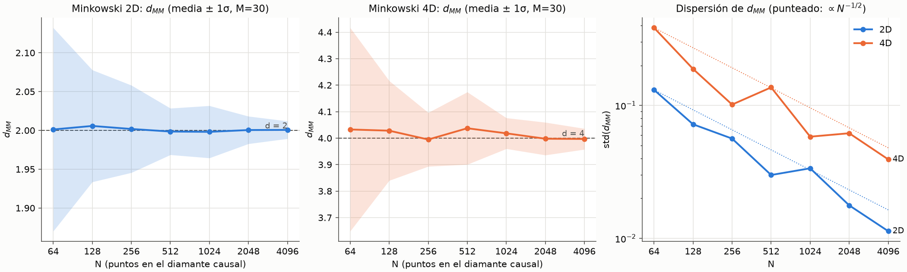

## Goal 2: acción de Benincasa-Dowker (completado)

Operador y acción (detalles y convenciones en el docstring de `causets/action.py`):

  (B_ε φ)(x) = α_d ℓ_ε⁻² [β_d φ(x) + ε Σ_{y≺x} f_d(n(y,x), ε) φ(y)],  S_ε = −s_d Σ_x ℓ² (B_ε 1)(x)

con (α, β, C_k) = (4, −1/2, {1,−2,1}) en 2D y (4/√6, −1, {1,−9,16,−8}) en 4D.

**Valores esperados exactos.** Por la fórmula de Mecke del proceso de Poisson,
E[Σ_{y≺x} h(n(y,x))] = ∫_{J⁻(x)} ρ dV_y E[h(Poisson(ρV(y,x)))]. Para x en el
vértice superior de un intervalo plano de volumen Λ (unidades de 1/ρ),
parametrizando y = x + τ(−cosh χ, sinh χ n̂) e integrando χ, la integral se
reduce a una variable:

  W[H](Λ) = ∫₀^Λ H(z) ln(Λ/z) dz                              (2D)
  W[H](Λ) = 3 ∫₀^Λ H(z) [√(Λ/z) − √(z/Λ) − ln(Λ/z)] dz        (4D)

Con los coeficientes BD, los términos en ln Λ y √Λ se cancelan y E[ℓ²B·1] → 0
(R = 0). La misma distribución de volúmenes da E[N_k] y E[S] para el diamante
entero (`continuum.py`). En de Sitter, por simetría máxima, V(y,x) sólo depende
del invariante Z = cosh(Hτ), y E[B·1](x) sólo de τ(p,x): se calcula como una
integral doble (cuadratura de Gauss-Legendre).

**Resultados** (todos con test en `tests/test_action.py` y `tests/test_de_sitter.py`):

1. Abundancias N_0..N_3 y acción media de sprinklings de diamantes 2D y 4D
   coinciden con los valores exactos (< 4 SEM).
2. E[ℓ²B·1] → 0 en Minkowski 2D y 4D, local y con ε = 0.1; la simulación en el
   vértice superior coincide con el valor exacto.
3. Acción 2D del diamante: ⟨S⟩ → 1 (= vértices − aristas + caras del teselado
   nulo, Benincasa-Dowker-Schmitzer 2011; ya es 1 con error < 10⁻⁶ para ρV ≥ 100).
4. de Sitter: E[B·1]/(−R/2) = 0.78 → 0.989 (2D) y 0.52 → 0.961 (4D) al bajar
   ℓH de 0.4 a 0.05, monótonamente; la simulación reproduce el valor exacto a
   densidad finita (< 4 SEM). Es decir, R = 12H² (4D) se recupera en el límite
   continuo, con correcciones grandes a densidad finita (~(ℓH)^1.4 en 4D).

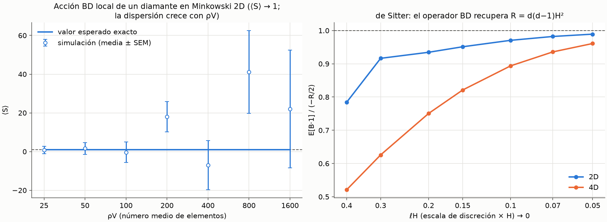

**Observaciones y limitaciones.**
- La dispersión de la acción y de B·1 crece con ρV (panel izquierdo; en 4D
  local, std(ℓ²B·1) ~ 100 a Λ = 100). Por eso la curvatura no se puede medir
  punto a punto: en de Sitter se promedia B_ε·1 sobre todos los puntos con
  ερV(p,x) ≥ 30 y se usa suavizado ε = 0.05. Estas fluctuaciones son el objeto
  del Goal 3.
- La media exacta sólo depende de ερ (el suavizado equivale a adelgazar el
  conjunto con probabilidad ε).
- La cuadratura de de Sitter está verificada hasta ℓH = 0.05 en 4D (resolución
  1 y 2 coinciden a 10⁻⁴ relativo); por debajo, la cancelación entre términos
  O(1) exige más precisión de la implementada.

## Goal 3: fluctuaciones de la acción BD (formalismo de Moradi-Yazdi-Zilhão)

Referencia: H. Moradi, Y. K. Yazdi & M. Zilhão, "Fluctuations and Correlations
in Causal Set Theory", Class. Quantum Grav. 42 (2025) 045017, arXiv:2407.03395
(MYZ; ecuaciones citadas según la v2 del arXiv). Código: `causets/fluctuations.py`
(formalismo), `causets/geometry.py` (geometrías), `tests/test_fluctuations.py`,
`scripts/goal3_fluctuations.py`.

**Qué acción.** Todo el Goal 3 trata la acción BD **local** (ε = 1), que es la
que MYZ descomponen: S = a_N N + Σ_{k<n_d} a_k N_k con a = (1, −2, 4, −2) en 2D
y (4/√6)(1, −1, 9, −16, 8) en 4D (normalización del Goal 2; la de MYZ, ec. 5.4,
difiere en una constante global, p. ej. factor −√6/2 en 4D). La acción
suavizada (ε < 1) depende de todas las N_n; se trata en la sección siguiente
("Ampliación del Goal 3").

**Qué se implementó del artículo.**
- Indicadores ζ_i (cardinalidad, MYZ 3.2/3.4) y χ (ocupación, 3.16):
  `cardinality_indicator`, `occupation_indicator`. Las reglas de correlación
  ζ-χ (3.31) y ζ-ζ con solapamiento (3.15, 3.34) se verifican directamente
  contra sprinklings (tests).
- (ΔS)² = aᵀ M a con M_ij = K_ij − L_iL_j = Cov(N_i, N_j), i, j = −1…n_d−1
  (MYZ 5.9-5.10), L_i por (5.15), M_{−1,−1} = ρV (5.20), M_{−1,j} de (5.26-5.27)
  — que se reduce a la identidad exacta M_{−1,j} = (j+2)L_j − (j+1)L_{j+1} — y
  K_ij = J¹+…+J⁶ (5.29-5.36) con las subregiones de D_2, D_3, D_6 (5.40-5.44)
  detectadas configuración a configuración.
- Lo que MYZ dejan como trabajo futuro: **evaluar las integrales**. Se hace por
  Monte Carlo con muestreo de importancia adaptado a la medida de volumen de
  intervalos casi nulos; J⁶ se evalúa ya restada L_iL_j (parte conexa) y
  partida en patrones (un extremo dentro del otro intervalo / sólo
  solapamiento) para evitar colas pesadas.
- **Minkowski 2D:** |A∩B| tiene forma cerrada (rectángulos en coordenadas de
  cono de luz) → predicción exacta salvo el error MC, que se reporta.
- **4D y de Sitter:** |A∩B| no tiene forma cerrada (MYZ sólo parametrizan
  J⁻(x₁)∩J⁻(x₂) en 2D, apéndice C.1). Se estima con K puntos MC y se usa la
  fórmula exacta de ⟨ζζ⟩ ("plugin"): sesgo O(1/K), medido comparando K. Hay
  también un modo insesgado (realización de Poisson local + ensayos
  geométricos para 1/|A∩B|), pero su varianza lo hace inútil en 4D.

**Decisión sobre N ≳ 2¹⁶ y termalización.** Cunningham & Krioukov (2018)
necesitan N grandes y termalización porque muestrean *dinámica* de causets con
cadenas de Markov. Aquí no hay cadena: cada sprinkling de Poisson es una
muestra independiente y exacta del ensemble, así que no hay termalización
posible ni necesaria. Y la predicción de MYZ es exacta a densidad finita, así
que la comparación es significativa a cualquier ρV: se usan ρV = 25…400 (2D)
con 4000 sprinklings por punto; el error del estimador de la varianza se
estima como std(d²)/√M con d = S − ⟨S⟩.

**Resultados en Minkowski 2D** (predicción exacta; margen de los tests fijado a
priori: |sim − pred| < 4σ_combinada):

| ρV | (ΔS)² predicción MYZ | (ΔS)² simulación (4000 sprinklings) | z | (ΔS)²/ρV |
|---|---|---|---|---|
| 25 | 638 ± 8 | 651 ± 17 | 0.64 | 26 |
| 50 | 1968 ± 24 | 1971 ± 48 | 0.06 | 39 |
| 100 | 5401 ± 68 | 5626 ± 126 | 1.56 | 54 |
| 200 | 14 099 ± 177 | 14 029 ± 317 | −0.19 | 70 |
| 400 | 34 734 ± 468 | 36 121 ± 830 | 1.46 | 87 |

Todas las densidades cumplen |z| < 4 (máximo 1.56). Los tests
(`tests/test_fluctuations.py`, ρV = 50 y 100) verifican además las reglas de
correlación ζ-χ (3.31) y ζ-ζ (3.34) contra sprinklings, y la fila M_{−1,j}
de la matriz de covarianza. Se comprobó que los tests pueden fallar: al
eliminar el patrón c0 de J⁶ los dos tests de varianza fallan.
Ajuste: (ΔS)² ∝ (ρV)^1.44 en este rango, es decir, ΔS ∝ (ρV)^0.72.

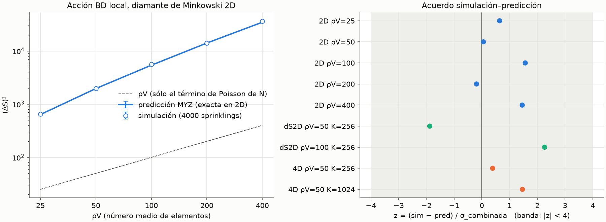

**Minkowski 4D (preliminar).** ρV = 50, 6000 sprinklings, predicción plugin:

| K (puntos para \|A∩B\|) | (ΔS)² predicción | (ΔS)² simulación | z |
|---|---|---|---|
| 256 | 10 142 ± 1000 | 10 542 ± 251 | 0.39 |
| 1024 | 9 616 ± 582 | 10 542 ± 251 | 1.46 |

Son compatibles, pero la predicción tiene un error del 6-10 % y un sesgo
O(1/K) que no se ha acotado con precisión en 4D. En Minkowski 2D, donde se
puede comparar con el cálculo exacto, el sesgo medido fue de ~+465 con K = 64
y ~+200 con K = 256 (ρV = 100, sobre ~5400). Es una verificación preliminar,
no estricta, y no tiene test automatizado.

**de Sitter 2D (exploratorio, no es una verificación).** MYZ no tratan de
Sitter. La extensión supone que su formalismo vale para cualquier variedad
(así lo afirman en el resumen) y usa: coordenadas conformes, donde la
relación causal es la de Minkowski; la medida física a(η)² d²x; y volúmenes
de intervalos exactos por simetría máxima. La región es η ∈ [−4, −0.3], H = 1,
con plugin K = 256:

| ρV | (ΔS)² predicción | (ΔS)² simulación | z |
|---|---|---|---|
| 50 | 2292 ± 161 | 1977 ± 47 | −1.88 |
| 100 | 4872 ± 408 | 5845 ± 136 | 2.26 |

Ambas quedan dentro de 4σ, pero con z de signos opuestos, errores del 7-8 %
y el sesgo de K = 256. No permiten afirmar un acuerdo fino: el resultado se
toma como una prueba de que el código funciona en geometría curva, no como una
predicción validada.

**Trabajo futuro.** (La cuadratura de |A∩B| en 4D, la acción suavizada y
más densidades en 4D se hicieron después: ver "Ampliación del Goal 3".)
Queda FLRW (Goal 4).

**¿Validan estos resultados usar las fluctuaciones para modelar Everpresent Λ?**

**No, con la acción local y en Minkowski los números no lo respaldan.**
Everpresent Λ supone fluctuaciones de tipo Poisson: δN ~ √N, de donde sale
ΔΛ ~ V^(−1/2). Si Λ se identificara con las fluctuaciones de la acción a
través del término −2ΛV (MYZ ec. 4.6), haría falta ΔS ~ √(ρV). Lo que se mide
es otra cosa:
- En 2D, (ΔS)² ∝ (ρV)^1.44, es decir, ΔS ∝ (ρV)^0.72. Eso daría
  ΔΛ ∝ V^(−0.28), no V^(−1/2).
- La varianza es de 26 a 87 veces mayor que ρV en 2D (y ~210 veces en 4D a
  ρV = 50). Está dominada por las correlaciones entre intervalos (términos
  J², J³, J⁴, J⁶), no por el término de Poisson de N.

Esto **no** descarta la idea en general. Queda abierto para: la acción
suavizada (pensada precisamente para reducir fluctuaciones); espaciotiempos
FLRW; y otras formas de extraer Λ que no sean la varianza total de S en un
diamante. Una hipótesis no comprobada aquí es que la mayor parte de la
varianza venga de intervalos casi nulos pegados a la frontera del diamante;
si fuera así, restar términos de frontera podría cambiar el escalado.

## Ampliación del Goal 3: acción suavizada y |A∩B| exacto en 4D

Código: `causets/fluctuations.py`, `causets/overlap.py`,
`tests/test_smeared_fluctuations.py`, `tests/test_overlap.py`,
`scripts/smeared_fluctuations.py` (resultados en
`figures/smeared_results_2d.json` y `figures/smeared_results_4d.json`).

**Acción suavizada como abundancias adelgazadas.** La función de suavizado de
Dowker & Glaser (2013) es f_d(n, ε) = Σ_k C_k B_k(n, ε), con
B_k(n, ε) = binom(n, k) ε^k (1−ε)^(n−k). Por tanto
S_ε = a_N N + Σ_{k<n_d} a_k Ñ_k, con Ñ_k = Σ_{y≺x} B_k(n(y,x), ε): el número
esperado de pares con k elementos entre ellos cuando cada elemento del
intervalo se conserva con probabilidad ε (`thinned_abundance_vector`,
`smeared_action_coefficients`). Así el formalismo MYZ se aplica sin cambios a
(N, Ñ_0, …), con estas modificaciones (extensión propia, no está en MYZ):
- ⟨Ñ_k⟩ = ρ²∫∫P_k(ερV): la densidad efectiva es ερ.
- J¹ deja de ser diagonal: los dos factores de un mismo par son
  adelgazamientos independientes del mismo intervalo.
- ⟨ζζ⟩ con solapamiento: adelgazar un proceso de Poisson da procesos de
  Poisson independientes. A∩B se reparte en "retenido por ambos" (ε²),
  "sólo por A" y "sólo por B" (ε(1−ε) cada uno), y la ec. (3.15) de MYZ se
  mantiene con ρ|A| → ερ|A| − ε²ρ|A∩B|, ρ|A∩B| → ε²ρ|A∩B|. Los puntos fijos
  dentro del intervalo se conservan con probabilidad ε (desplazamiento
  binomial) (`thinned_joint_probability`).
- La fila M_{−1,k} = (k+2)L_k − (k+1)L_{k+1} sigue valiendo (fórmula de Mecke).

**|A∩B| exacto en 4D** (`overlap.py`). A t fijo cada cono es una bola y a
(t, z) fijos un disco. El área de la intersección de los 4 discos se calcula
exactamente con el teorema de Green (arcos de circunferencia) y se integra con
Gauss-Legendre en t (partido en los instantes de tangencia, que son lineales
en t) y en z. Verificado contra casos exactos (tolerancia relativa 1e-3) y
contra Monte Carlo con 10⁶ puntos (4σ). Sustituye al estimador plugin, que
tenía un sesgo O(1/K).

Los tests fallan con errores deliberados: con el área de los discos ×1.01
fallan los 4 tests de área/volumen; con ε en vez de ε² en la probabilidad
conjunta fallan el test contra sprinklings y el de la varianza.

**Resultados en Minkowski 2D, acción suavizada** (4000 sprinklings por punto;
predicción con 4·10⁶ (ε = 0.5) y 10⁷ (ε = 0.25) muestras MC por término):

| ρV | ε = 0.5 predicción | ε = 0.5 simulación | z | ε = 0.25 predicción | ε = 0.25 simulación | z |
|---|---|---|---|---|---|---|
| 25 | 12.59 ± 0.27 | 13.36 ± 0.36 | 1.72 | 0.576 ± 0.015 | 0.595 ± 0.016 | 0.86 |
| 50 | 39.8 ± 0.9 | 40.5 ± 1.0 | 0.55 | 2.09 ± 0.05 | 2.10 ± 0.05 | 0.21 |
| 100 | 117.3 ± 2.7 | 113.4 ± 2.6 | −1.03 | 6.46 ± 0.17 | 6.24 ± 0.15 | −0.96 |
| 200 | 295 ± 8 | 299 ± 7 | 0.41 | 17.7 ± 0.5 | 17.2 ± 0.4 | −0.74 |
| 400 | 733 ± 22 | 748 ± 17 | 0.56 | 43.4 ± 1.6 | 45.3 ± 1.0 | 0.98 |

Los 10 puntos cumplen |z| < 4 (máximo 1.72). Ajuste ponderado de la
simulación, ΔS ∝ (ρV)^p:

| ε | p |
|---|---|
| 1 (local) | 0.718 ± 0.006 |
| 0.5 | 0.722 ± 0.006 |
| 0.25 | 0.772 ± 0.006 |

**Resultados en Minkowski 4D, acción local, |A∩B| por cuadratura** (6000
sprinklings por punto):

| ρV | (ΔS)² predicción | (ΔS)² simulación | z | (ΔS)²/ρV |
|---|---|---|---|---|
| 25 | 1899 ± 82 | 1840 ± 97 | −0.46 | 74 |
| 50 | 9775 ± 332 | 10 234 ± 249 | 1.10 | 205 |
| 100 | 51 224 ± 12 003 | 53 932 ± 1144 | 0.22 | 539 |

Con ρV = 50 el error de la predicción baja al 3.4 % (plugin: 6–10 % más un
sesgo sin acotar). Con ρV = 100 el error MC es del 23 % (colas pesadas con
5·10⁵ muestras): el acuerdo es real pero poco exigente. Ajuste de la
simulación: **ΔS ∝ (ρV)^1.21 ± 0.02 en 4D** (la predicción da 1.18 ± 0.04).
Este punto no tiene test automatizado: es caro (~10–30 min por densidad).

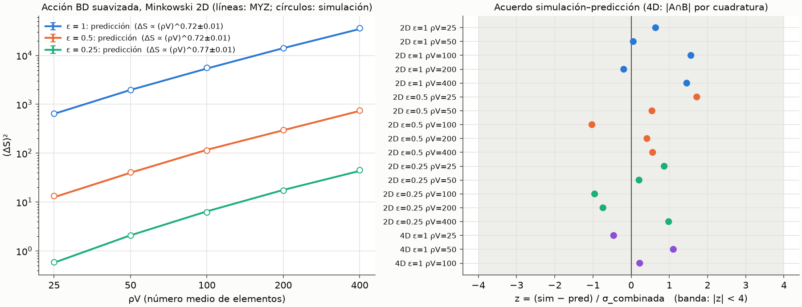

**Conclusión para Everpresent Λ.** El suavizado reduce mucho la amplitud de
las fluctuaciones: con ρV = 400 en 2D, (ΔS)² pasa de ~35 000 (ε = 1) a ~750
(ε = 0.5) y ~45 (ε = 0.25). Pero **no mejora el escalado**: p no baja hacia
el 0.5 de Poisson. Se mantiene en 0.72 con ε = 0.5 y sube a 0.77 con
ε = 0.25. Con ε = 0.25, ερV sólo va de 6 a 100, así que es probable que sea un
régimen pre-asintótico; el escalado para ε → 0 con ερV → ∞ sigue abierto.
En 4D, con la acción local, el escalado es aún peor (p ≈ 1.2, y (ΔS)²/ρV
crece de 74 a 539). Así que, también con la acción suavizada, la varianza
total de S en un diamante de Minkowski no tiene el escalado de Poisson que
supone Everpresent Λ.

## Goal 3c: ¿es robusto el exponente? ¿Qué exige realmente Everpresent Λ?

### Fase 1: qué exige el modelo Everpresent Λ (Model 1)

Fuente: S. Das, A. Nasiri & Y. K. Yazdi, "Aspects of Everpresent Λ (I): A
Fluctuating Cosmological Constant from Spacetime Discreteness", JCAP 10 (2023)
047, arXiv:2304.03819 (PDF en `references/`). Se revisó también la Parte II
(JCAP 10 (2024) 076, arXiv:2307.13743), que contrasta el modelo con supernovas
Ia y CMB y no trata el exponente de escalado.

**1. De dónde sale el exponente 1/2: de la relación número-volumen, no de la
acción BD.** El artículo deriva δΛ ∝ V^(−1/2) en tres pasos:
- Fluctuación de Poisson de N (sec. 2, ec. 2.2): "the standard deviation
  δN = √(ρ_cs V), which is also the smallest possible deviation [29] from an
  exact number-volume correspondence", es decir, δV = √N/ρ_cs.
- Relación de incertidumbre entre Λ y V en gravedad unimodular (ecs. 3.4-3.5):
  δΛ/(8πG) = (ℏ/2)(1/δV).
- Combinando ambas, δΛ = 4π(ℓ_p/ℓ_cs)² (1/√V) (ec. 3.6), y por tanto
  δΛ ∼ H² (ec. 3.7).

La acción de Benincasa-Dowker-Glaser sólo aparece para definir la integral de
camino Z(N) = Σ e^{iS_BDG} (ec. 2.3). **En ningún momento se identifica Λ con
las fluctuaciones de S_BDG.** Esa identificación, a través del término −2ΛV
de MYZ (ec. 4.6), es una hipótesis de este proyecto, no del modelo.

**2. Model 1 impone el exponente 1/2 por construcción** (sec. 3.1).
- "We next make the ansatz that (3.8) is true even element-wise, in the sense
  that each causal set element contributes a random variable with standard
  deviation 8πα/ℓ²_cs to Λ" (ec. 3.10).
- S_Λ es la suma de esas variables independientes (ec. 3.11). Por el teorema
  central del límite, S_Λ ∼ N(0, √N/2) y Λ(x) ∼ N(0, 8πα/√V) (ec. 3.13).
- La recursión (3.14-3.16) añade √ΔV ξ_n con ξ_n normal estándar e
  independiente: es un paseo aleatorio.
- Lo único flexible es la forma de la distribución: "any other distribution
  with mean 0 and standard deviation 8πα/ℓ²_cs would work just as well for
  our purposes".
- El único parámetro libre es α (ec. 3.9), que fija la **amplitud** (se
  exploran α = 0.005-0.012, sec. 5). Ningún parámetro del modelo puede
  absorber otro exponente.
- Los autores admiten que "the true causal set mechanism that gives rise to
  Everpresent Λ is not fully understood".
- Model 2 (sec. 5.4.1) sustituye la dinámica por un proceso gaussiano en
  Ω_Λ, con parámetros α̃ y µ que fijan amplitud y tiempo de correlación. Está
  construido para reproducir la misma propiedad de Model 1: Ω_Λ = O(1) en
  todas las épocas.

**3. Por qué otro exponente no es tolerable** (derivación propia, no está en
el artículo, que no discute otros exponentes). Si las fluctuaciones de la
acción escalan como ΔS ∝ N^p y Λ ∼ S/V, entonces ΔΛ ∝ V^(p−1). Con V ∼ H^(−4):

  ΔΛ / H² ∝ H^(2 − 4p).

Sólo con p = 1/2 la fracción Ω_Λ fluctúa con amplitud constante en todas las
épocas. Eso es lo que da nombre al modelo ("Everpresent") y lo que resuelve el
problema de la constante cosmológica "without fine tuning" (resumen). Con
p = 0.72, ΔΛ/H² ∝ H^(−0.88): la energía oscura crece sin límite respecto a la
densidad crítica a medida que H disminuye. Con p ≈ 1.2 (4D), ΔΛ crece en
términos absolutos con el volumen. Ajustar α sólo puede hacer Ω_Λ ∼ 1 en una
época concreta (hoy), y eso es exactamente el ajuste fino que el modelo
pretende evitar. Además, sin p = 1/2 desaparece el paseo aleatorio de
incrementos independientes (3.15) en el que se basa la simulación de Model 1.

**Respuesta de la Fase 1.** El modelo exige estrictamente el exponente 1/2,
pero lo obtiene de la fluctuación de Poisson del número de elementos (δN =
√N), con contribuciones independientes por elemento. No lo obtiene de la
acción BD. El exponente no es un parámetro ajustable: α sólo controla la
amplitud.

### Fase 2: régimen ερV > 100 (Minkowski 2D)

Código: `scripts/goal3c_asymptotic.py` (resultados en `figures/goal3c_sim.json`,
`figures/goal3c_pred.json` y `figures/goal3c_results.json`), tests en
`tests/test_asymptotic_scaling.py`.

**Coste y alcance.** Sólo 2D. La cuadratura de |A∩B| en 4D cuesta ~10–30 min
por densidad ya con ρV ≤ 100 (ver la ampliación del Goal 3), y la simulación
4D con ρV ≫ 100 no es viable en este equipo. En 2D se llegó a ρV = 3200 con
2000 sprinklings por densidad. Cada sprinkling de ρV = 3200 cuesta varios
segundos (~1.5 h en total). Los mismos sprinklings sirven para ε = 1, 0.5 y
0.25, así que ερV va de 200 a 3200: más de un orden de magnitud por encima de
100.

**Reglas fijadas antes de ver los resultados:**
- acuerdo simulación-predicción: |z| < 4 (σ combinada);
- p compatible con 0.5: |p − 0.5| < 4σ_p;
- p estable entre regímenes: |p_alto − p_bajo| < 4σ combinada.

**Resultados:**

| ρV | ε | (ΔS)² predicción | (ΔS)² simulación | z |
|---|---|---|---|---|
| 800 | 1 | 84 994 ± 852 | 89 698 ± 2856 | 1.58 |
| 800 | 0.5 | 1811 ± 42 | 1810 ± 58 | −0.02 |
| 800 | 0.25 | 103.7 ± 3.3 | 108.8 ± 3.6 | 1.03 |
| 1600 | 1 | 202 790 ± 2209 | 199 363 ± 6130 | −0.53 |
| 1600 | 0.5 | 4113 ± 109 | 4176 ± 128 | 0.37 |
| 1600 | 0.25 | 250.4 ± 9.1 | 268.2 ± 8.4 | 1.43 |
| 3200 | 1 | 457 192 ± 5463 | 456 621 ± 14 357 | −0.04 |
| 3200 | 0.5 | 9601 ± 283 | 9325 ± 292 | −0.68 |
| 3200 | 0.25 | 609 ± 24 | 602 ± 19 | −0.24 |

Los 9 puntos cumplen |z| < 4 (máximo 1.58): el formalismo MYZ extendido
sigue siendo exacto también en este régimen.

Exponentes (ajuste ponderado de la simulación, ΔS ∝ (ρV)^p):

| ε | p (ρV = 25–400) | p (ρV = 800–3200) | salto entre regímenes | p alto vs 0.5 |
|---|---|---|---|---|
| 1 | 0.718 ± 0.006 | 0.587 ± 0.016 | −7.7σ | +5.4σ |
| 0.5 | 0.722 ± 0.006 | 0.591 ± 0.016 | −7.6σ | +5.6σ |
| 0.25 | 0.772 ± 0.006 | 0.617 ± 0.017 | −8.9σ | +7.0σ |

Según las reglas fijadas: **el exponente NO es estable** (baja más de 7σ) y
**sigue sin ser compatible con 0.5** (más de 5σ por encima). Las
predicciones dan lo mismo (p alto = 0.608, 0.601, 0.638).

**El exponente es efectivo, no asintótico** (análisis hecho *a posteriori*,
tras ver los datos). El exponente local entre densidades consecutivas
(predicciones, ρV = 25 → 3200) baja de forma sostenida, sin estabilizarse:

- ε = 1: 0.81, 0.73, 0.69, 0.65, 0.65, 0.63, 0.59
- ε = 0.5: 0.83, 0.78, 0.66, 0.66, 0.65, 0.59, 0.61
- ε = 0.25: 0.93, 0.82, 0.73, 0.65, 0.63, 0.64, 0.64

Una ley de potencias única se rechaza con fuerza al ajustar (ΔS)²/ρV en todo
el rango (χ²/dof = 94, 36 y 43). La forma (ΔS)² = ρV(a + b ln ρV) ajusta
mucho mejor (χ²/dof = 11.7, 1.8 y 2.0; con ε = 1 hace falta algo más en las
densidades bajas). Si esa forma es la correcta, ΔS ∝ √(ρV ln ρV)
asintóticamente: escalado de Poisson **con una corrección logarítmica**, y el
"0.72" del Goal 3 sería un exponente efectivo de densidades pequeñas.
Esta forma se formuló como hipótesis tras ver los datos. **El Goal 3d
(sección siguiente) la deriva y la verifica** para el término dominante, y
muestra que no es un efecto de frontera.

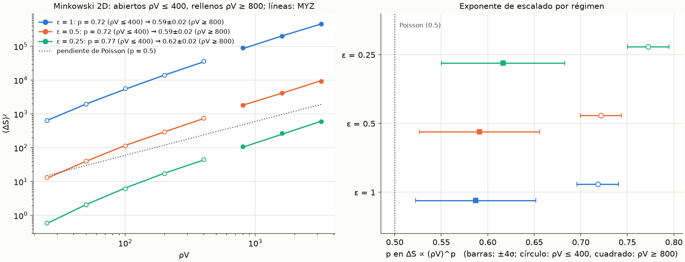

**Tests** (`tests/test_asymptotic_scaling.py`, márgenes fijados de antemano):
- un punto calculado en vivo con ε = 0.2 y ρV = 600 (ερV = 120), a 4σ;
- comprobación de los 9 puntos del cálculo largo (|z| < 4) y de que los
  exponentes p_sim y p_pred del régimen alto coinciden a 4σ.

Con el error deliberado ε → ε² en la probabilidad conjunta, el test en vivo
falla.

### Fase 3: veredicto

**¿Hay alguna versión del mecanismo compatible con lo que exige
Everpresent Λ?** Con los datos de este proyecto, **no**:

1. **Exponente.** Ninguna versión probada da p = 0.5: ni la local, ni la
   suavizada con ε = 0.5 o 0.25, ni el régimen ερV de 200 a 3200 (todas más
   de 5σ por encima con la regla fijada). En 4D, la única evidencia
   (acción local, ρV ≤ 100) es p ≈ 1.2, mucho peor. Lo más cerca que se llega
   es la tendencia 2D hacia un escalado de Poisson con corrección
   logarítmica. Aun en ese caso, ΔΛ ∝ V^(−1/2)·√ln V no es exactamente lo que
   pide el modelo, y no hay ningún dato que diga que pase lo mismo en 4D.
2. **Mecanismo.** Aunque el exponente fuera 1/2, el modelo (Fase 1) **no**
   deriva Λ de las fluctuaciones de la acción BD. Las deriva de la
   fluctuación de Poisson de N y de contribuciones independientes por
   elemento (ecs. 2.2, 3.6, 3.10-3.11). Las fluctuaciones de S_BD están
   dominadas por correlaciones entre intervalos, que son justo lo contrario
   de contribuciones independientes. Además, Model 1 usa el cono de luz
   pasado, no un diamante.
3. **Amplitud.** (ΔS)²/ρV va de ~0.2 a ~140 según ε y ρV; no es una
   constante O(1) por elemento. α sólo absorbería una amplitud fija.

**¿Tiene base viable el Goal 4 tal como está planteado?** **No.** Generar
realizaciones estocásticas de Λ(t) con Model 1 "a partir de las
fluctuaciones de la acción BD" supondría un mecanismo que ni el artículo
propone ni los datos de este proyecto respaldan. Model 1 se puede simular
tal cual, pero entonces es independiente de todo el trabajo de los Goals 2-3
y no aportaría nada nuevo.

**Propuesta para el Goal 4** (no implementada):
- Documentar como hallazgo del proyecto que las fluctuaciones de la acción BD
  en un diamante de Minkowski no tienen el escalado de Poisson que requiere
  Everpresent Λ: p efectivo de 0.6–0.8 en 2D y ~1.2 en 4D a las densidades
  accesibles. Incluir las cotas cuantitativas de este README.
- Antes de FLRW, cerrar la pregunta abierta más importante: ¿en 4D el
  exponente efectivo también baja con ρV, como en 2D? La predicción MYZ es
  más barata que la simulación en densidades altas, pero en 4D la cuadratura
  es el cuello de botella: hace falta acelerarla o reducir su precisión de
  forma controlada.
- Comprobar en 2D la hipótesis ρV(a + b ln ρV) con una predicción
  independiente (análisis asintótico del formalismo MYZ, o densidades
  mayores), y localizar de dónde sale el logaritmo, por ejemplo separando
  las contribuciones de la frontera.
- Si se va a FLRW, hacerlo como **medida** y no como supuesto: calcular ΔS
  en conos de luz pasados de FLRW y comparar con δΛ ∝ V^(−1/2), en vez de
  generar Λ(t) suponiendo que la relación se cumple.

## Goal 3d: origen del logaritmo en 2D

Código: `causets/fluctuations.py` (`pair_weight`, `same_pair_log_coefficient`),
`scripts/goal3d_log_origin.py` (resultados en `figures/goal3d_terms.json`,
`figures/goal3d_rapidity.json` y `figures/goal3d_results.json`), tests en
`tests/test_log_origin.py`.

**Hipótesis (formulada antes del cálculo).** El logaritmo viene del término
"mismo par" (J¹ de MYZ): el ruido de Poisson del *número* de intervalos. En
coordenadas de cono de luz (diamante de lado ℓ, V = ℓ²/2):

  ⟨Σ_pares h(n)⟩ = (ρ²/4) ∫∫₀^ℓ (ℓ−a)(ℓ−b) E_{n~Poisson(ρab/2)}[h(n)] da db.

A producto ab = x fijo, la integral ∫_{x/ℓ}^{ℓ} da/a = ln(ℓ²/x) cuenta el
**rango de rapidez** de los intervalos casi nulos de volumen fijo, que el
tamaño del diamante corta. Como ∫₀^∞ P_n(μ) dμ = 1:

  ⟨Σ_pares h(n)⟩ = ρV ln(ρV) · Σ_n h(n) + O(ρV).

Con h = f_ε², donde f_ε(n) es la contribución de un par a la acción, sale
(ΔS)² ⊇ b(ε) ρV ln ρV con **b(ε) = Σ_n f_ε(n)²**: b(1) = Σa_k² = 24,
b(0.5) = 0.395, b(0.25) = 0.0228. El término cruzado con N lleva
Σ_n f_ε(n) = 0 y no tiene logaritmo.

**Verificaciones:**
- ⟨N_k⟩/ρV − ln ρV converge a una constante (integral exacta hasta
  ρV = 10⁶): el coeficiente del logaritmo es 1 para todo k.
- El aumento por década de ⟨Σ f_ε²⟩/ρV, dividido por ln 10, da 23.998,
  0.39503 y 0.02285 frente a b = 24, 0.39506 y 0.02285 (integral exacta, sin
  Monte Carlo).
- **Descomposición de la predicción MYZ** por términos (ρV = 50 … 12 800;
  la suma reproduce la varianza total exactamente). El aumento de J¹/ρV en
  cada factor 4 de ρV converge a b(ε)·ln 4:

| ε | aumentos de J¹/ρV | b(ε)·ln 4 |
|---|---|---|
| 1 | 30.0, 32.2, 32.9, 33.2 | 33.27 |
| 0.5 | 0.503, 0.533, 0.541, 0.549 | 0.548 |
| 0.25 | 0.0284, 0.0305, 0.0315, 0.0315 | 0.0316 |

**No es un efecto de frontera.** Sobre 20 sprinklings con ρV = 3200, la
contribución de los pares a Σ f_ε(n)² repartida por rapidez η = ½ ln(Δu/Δv)
forma una **meseta**: aproximadamente constante para |η| ≲ 3 y cortada en
|η| ≈ ½ ln ρV = 4.0. Su altura (22.9 / 0.38 / 0.0219 por unidad de η) es
~96 % de b(ε). Cada unidad de rapidez aporta lo mismo; los pares pegados a
los bordes nulos (|η| > 4) aportan poco. La frontera sólo fija dónde se corta
el rango de rapidez. El logaritmo es un efecto de la invariancia de Lorentz
(boosts) cortada por el tamaño finito de la región. Además, J¹/ρV medido sobre
sprinklings (137.1) coincide con la predicción (137.7).

**Los otros términos** (ajuste T/ρV = c + b ln ρV, ρV = 50 … 12 800):

| ε | b total | b(J¹) predicho | b(J²+J³+J⁴) | b(J⁶ conexo) |
|---|---|---|---|---|
| 1 | 24.43 ± 0.24 | 24 | ≈ −0.3 | 2.04 ± 0.21 |
| 0.5 | 0.540 ± 0.016 | 0.395 | ≈ +0.014 | 0.151 ± 0.015 |
| 0.25 | 0.0350 ± 0.0014 | 0.0228 | ≈ +0.005 | 0.0063 ± 0.0012 |

- J², J³ y J⁴ son O(ρV): planos a densidad alta. El pequeño b de J⁴ con
  ε = 0.25 sale de su subida a densidad baja; desde ρV = 200 es plano.
- **J⁶ conexo** (correlaciones entre intervalos solapados) también crece.
  Con la acción local es secundario: el b total, 24.43 ± 0.24, es
  compatible con 24. Con la acción suavizada explica la diferencia con la
  fórmula de J¹ (con ε = 0.5, ~28 % de la pendiente). **No se ha determinado
  su forma funcional**: sus errores de Monte Carlo crecen con ρV, y con
  ε = 1 salta de 9.4 ± 1.5 a 20.1 ± 2.2 entre ρV = 3200 y 12 800 (~4σ),
  sin que se pueda distinguir una fluctuación de cola de un crecimiento real.

**Tests:** 13 en `tests/test_log_origin.py`. Incluyen el coeficiente 1 de
⟨N_k⟩, b(1) = 24, Σf_ε = 0, b(0.5) por integral exacta, el cierre de la
descomposición, el b total de la acción local frente a 24 y el último aumento
de J¹ frente a b(ε)·ln 4. Los márgenes de los dos últimos son el estándar
del proyecto (4σ), aunque los valores ya se habían visto. Con b multiplicado
por 1.02 de forma deliberada, fallan los 4 tests que dependen de b.

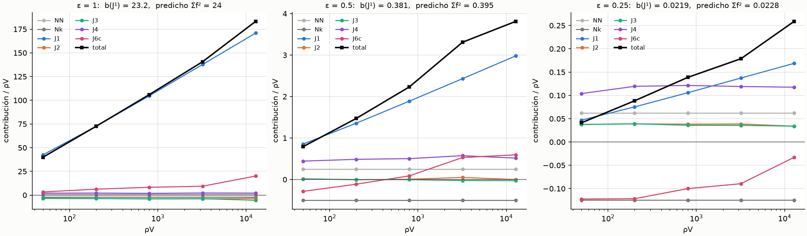

**Consecuencias:**
1. **El exponente asintótico en 2D es 1/2 con corrección logarítmica, al
   menos para el término dominante:** (ΔS)² = b(ε) ρV ln ρV + …, es decir,
   ΔS ∝ √(ρV ln ρV). Los "0.72" (Goal 3) y "0.59–0.62" (Goal 3c) son
   exponentes efectivos de ese crecimiento logarítmico a densidades finitas.
   La regla del Goal 3c ("incompatible con 0.5") sigue siendo correcta para
   un ajuste de potencia pura en ese rango, pero la ley real no es una
   potencia. Queda abierta la contribución de J⁶.
2. **Everpresent Λ:** en 2D las fluctuaciones de la acción son "casi de
   Poisson" (Poisson por un logaritmo). Siguen en pie las otras dos
   objeciones de la Fase 3 del Goal 3c: el modelo no deriva Λ de la acción BD,
   y la amplitud b(ε) depende del suavizado. Además, el logaritmo aquí es
   ln(ρV) del diamante: no es universal y depende de la forma de la región.
3. **Predicción para 4D (paso 2, sin comprobar):** el mismo argumento da
   ⟨N_k⟩ ∝ (ρV)^(2−2/d) = (ρV)^1.5 (confirmado numéricamente para ⟨N_0⟩:
   exponente local 1.72 → 1.52 entre ρV = 10² y 10⁶). Si J¹ domina como en
   2D, el exponente asintótico en 4D sería **p = 0.75, no 0.5**: los intervalos
   casi nulos, con su rango de boosts, crecen más rápido que N. El p ≈ 1.2
   medido con ρV ≤ 100 sería pre-asintótico. **Confirmado en el Paso 2.**

## Paso 2: escalado en 4D

Código: `scripts/step2_4d_scaling.py` (resultados en `figures/step2_4d_sim.json`,
`figures/step2_4d_sim_extra.json` y `figures/step2_4d_results.json`), tests en
`tests/test_4d_scaling.py`.

**Predicción (derivada antes de calcular).** El argumento del Goal 3d en d
dimensiones: los pares con tiempo propio τ pequeño tienen rapidez χ ≲ ln(L/τ),
y la medida del hiperboloide ∫ sinh^(d−2)χ dχ ~ (L/τ)^(d−2). Con
μ = ρ·(volumen del intervalo):

  ⟨Σ_pares h(n)⟩ ∝ (ρV)^(2−2/d) · Σ_n h(n) Γ(n + 2/d)/n! + …

- d = 2: Γ(n+1)/n! = 1 y aparece el logaritmo (caso marginal, Goal 3d).
- d = 4: J¹ = Σ a_k² ⟨N_k⟩ ∝ (ρV)^1.5, es decir, **p → 1 − 1/d = 0.75**.
- El término cruzado con N lleva Σ_k a_k Γ(k+½)/k! = −1 + 9/2 − 6 + 5/2 = 0:
  no crece. Es la misma cancelación que hace finita la media de la acción.

**J¹ exacto** (integrales de `continuum.expected_abundance`, sin Monte
Carlo). Su exponente local baja muy despacio hacia 0.75:

| ρV | 25→50 | 100→200 | 400→800 | 1600→3200 | 10⁴→10⁵ | 10⁵→10⁶ |
|---|---|---|---|---|---|---|
| p local de J¹ | 1.26 | 1.09 | 0.96 | 0.88 | 0.80 | 0.77 |

⟨N_k⟩/(ρV)^1.5, normalizado por Γ(k+½)/k!, converge a un valor común: la
dispersión entre k = 0…3 pasa de 27 % (ρV = 10⁴) a 13 % (10⁵) y 5.5 % (10⁶).

**Simulación** (acción local, ρV = 25 … 6400; con ρV = 3200 hay dos tandas,
2000 sprinklings en total, y con ρV = 6400 hay 500):

| ρV | (ΔS)²/ρV simulación | J¹/ρV exacto | resto/J¹ | p local (total) |
|---|---|---|---|---|
| 25 | 73.6 ± 3.9 | 56.0 | 0.32 ± 0.07 | |
| 50 | 204.7 ± 5.0 | 160.8 | 0.28 ± 0.03 | 1.24 ± 0.04 |
| 100 | 539 ± 11 | 407.6 | 0.33 ± 0.03 | 1.20 ± 0.02 |
| 200 | 1224 ± 40 | 921.4 | 0.33 ± 0.04 | 1.09 ± 0.03 |
| 400 | 2488 ± 77 | 1892.5 | 0.32 ± 0.04 | 1.01 ± 0.03 |
| 800 | 4787 ± 146 | 3596.9 | 0.33 ± 0.04 | 0.97 ± 0.03 |
| 1600 | 8359 ± 346 | 6425.6 | 0.30 ± 0.05 | 0.90 ± 0.04 |
| 3200 | 15 415 ± 508 | 10 927 | 0.41 ± 0.05 | 0.94 ± 0.04 |
| 6400 | 20 979 ± 1272 | 17 869 | 0.17 ± 0.07 | 0.72 ± 0.05 |

"Resto" = total − J¹ − NN − cruzado, es decir, la suma de los términos de
correlación de MYZ. **Regla fijada antes de la segunda tanda:** si las
correlaciones crecen como J¹, la pendiente de resto/J¹ frente a ln ρV es
compatible con 0 a 4σ. Resultado: +0.0056 ± 0.0091 (0.6σ, χ²/dof = 1.39).
**Se cumple.** La fracción media es resto/J¹ = 0.317 ± 0.014, es decir,
(ΔS)² ≈ 1.32·J¹ en todo el rango.

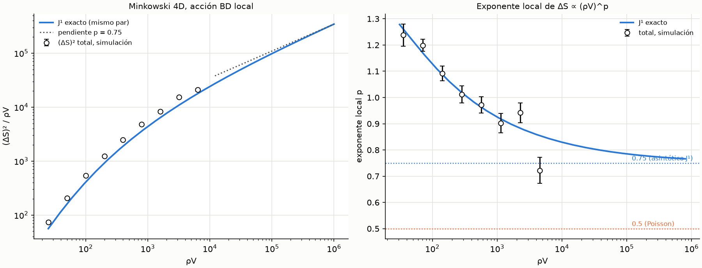

**Conclusiones:**
1. **El p ≈ 1.2 medido con ρV ≤ 100 (Goal 3) es pre-asintótico**, y se
   explica entero: el propio J¹ tiene exponente local 1.26–1.17 ahí. A medida
   que crece ρV, el exponente local de la varianza total sigue al de J¹ hacia
   abajo.
2. **Asintóticamente, ΔS ∝ (ρV)^0.75 en 4D.** Esto se apoya en dos piezas.
   Una es exacta: J¹ → (ρV)^1.5. La otra es empírica hasta ρV = 6400: las
   correlaciones son una fracción constante de J¹. Que esa proporcionalidad
   siga hasta ρV → ∞ es una extrapolación.
3. **En general, p = 1 − 1/d.** El origen es el mismo en cualquier
   dimensión: el número de intervalos casi nulos de volumen fijo crece con el
   rango de boosts disponible dentro de la región, (L/τ)^(d−2), más deprisa que
   el número de elementos. Sólo en d = 2 sale 1/2, y con logaritmo (caso
   marginal).
4. **Acción suavizada:** el mismo argumento da J¹ ∝ (ρV)^1.5 ·
   Σ_n f_ε(n)² Γ(n+½)/n! con ε fijo. El suavizado cambia la amplitud, no el
   exponente. (No se ha simulado en 4D.) Si ε escalara con ρ, manteniendo
   fija la escala de no localidad, el análisis sería otro.
5. **Everpresent Λ:** en 4D, que es el caso físico, Λ ∼ S/V daría
   ΔΛ ∝ V^(−1/4), no V^(−1/2). Con los V cosmológicos (ρV ~ 10²⁴⁰), la
   asíntota es la relevante. Esto refuerza el veredicto del Goal 3c con un
   mecanismo explícito: las fluctuaciones de la acción BD en un diamante de
   Minkowski 4D **no** tienen el escalado de Poisson. No lo tienen por una
   razón estructural (los boosts), no por falta de densidad.

## Punto 1a: el cono de luz pasado truncado (Minkowski 2D)

Código: `causets/regions.py` (`TruncatedPastCone`), `causets/geometry.py`
(`MinkowskiConeGeometry`), `causets/continuum.py` (`cone_pair_integral_2d`,
`expected_abundance_cone`), `scripts/cone_fluctuations.py` (resultados en
`figures/cone_sim.json`, `figures/cone_pred.json` y `figures/cone_results.json`),
tests en `tests/test_cone.py`.

**Motivación.** Everpresent Λ no usa un diamante: usa el pasado causal del
observador hasta la superficie inicial. Todos los resultados anteriores son
para diamantes, y su mecanismo (el rango de boosts) depende de la región. Aquí
se usa el análogo plano: el cono pasado truncado J⁻(q) ∩ {t ≥ 0}, con
q = (h, 0) y V = h² en 2D. Es causalmente convexo, así que el formalismo MYZ
se aplica sin cambios. Sólo cambian el dominio y las medias exactas.

**Hipótesis y criterios (fijados antes de calcular).** El coeficiente del
logaritmo de J¹ sale del rango de rapidez ln ρ de los intervalos casi nulos.
La forma de la región sólo debería cambiar la constante O(ρV). Si es así,
en el cono (ΔS)² ⊇ b(ε) ρV ln ρV con el mismo b(ε) = Σf_ε² que en el diamante.
Criterios: C1, ⟨N_k⟩ exacto frente a sprinklings con |z| < 4. C2, el
coeficiente del logaritmo de ⟨Σf_ε²⟩ en el cono es b(ε) (integral exacta,
tolerancia relativa 10⁻³). C3, la predicción MYZ coincide con la simulación
con |z| < 4. C4, el b total del cono (ε = 1) es compatible a 4σ con el del
diamante (24.43 ± 0.24).

**Fórmula exacta.** En coordenadas de cono de luz el cono es
{u, v ≤ h, u + v ≥ 0}. Un par con lados Δu = a y Δv = b cabe si su vértice
inferior está en un triángulo de área física (2h − a − b)²/4. Con ρ = 1 y
μ = ab/2:

  ⟨Σ_pares H(n)⟩ = ¼ ∫₀^{ρV/2} E_{n~Poisson(μ)}[H(n)] · I(μ) dμ,
  I(μ) = ∫_{a₋}^{a₊} (c − a − k/a)² da/a,  c = 2h, k = 2μ,

con a± las raíces de a² − ca + k = 0 (primitiva cerrada en el código). A μ
fijo, I(μ) = 4ρV ln(ρV/μ) + O(ρV). Se ha comprobado frente a la integral doble
directa (error relativo < 10⁻⁸). ⟨N_0⟩/ρV − ln ρV converge a −1.7296 en el
cono y a −1.4228 en el diamante: **el coeficiente del logaritmo es el mismo
(1) y sólo cambia la constante.**

**Resultados** (simulación: 4000/4000/3000/2000 sprinklings; MYZ: 2·10⁶
muestras con ε = 1 y 4·10⁶ con ε = 0.5):

| ρV | ε = 1: simulación | ε = 1: MYZ | z | ε = 0.5: simulación | ε = 0.5: MYZ | z |
|---|---|---|---|---|---|---|
| 50 | 1708 ± 45 | 1647 ± 13 | +1.28 | 34.80 ± 0.92 | 34.71 ± 0.63 | +0.08 |
| 200 | 12 843 ± 289 | 12 823 ± 102 | +0.06 | 273.9 ± 6.2 | 272.5 ± 5.8 | +0.16 |
| 800 | 81 381 ± 2094 | 79 300 ± 696 | +0.94 | 1664 ± 46 | 1684 ± 46 | −0.31 |
| 3200 | 445 300 ± 14 000 | 431 500 ± 4400 | +0.93 | 9465 ± 310 | 9228 ± 320 | +0.53 |

- **C1:** máximo |z| = 1.73 sobre las 32 medias ⟨Ñ_k⟩. **Se cumple.**
- **C2:** pasan los tests con ε = 1 y 0.5. **Se cumple.**
- **C3:** 8/8 puntos con |z| < 4 (máximo 1.28). **Se cumple.**
- **C4:** con ε = 1 y ρV = 50 … 12 800, b = 24.09 ± 0.19 frente a
  24.43 ± 0.24 en el diamante (z = −1.09). **Se cumple.** El χ²/dof del
  ajuste es 7.9: la ley c + b ln ρV sólo vale asintóticamente. Los aumentos
  de J¹/ρV por factor 4 de ρV, divididos por ln 4, son 21.3, 23.1, 23.7 y
  23.9 (→ 24).
- **ε = 0.5:** b = 0.500 ± 0.013 frente a Σf² = 0.395. La diferencia es
  J⁶ conexo, como en el diamante (0.540 ± 0.016).
- **Exponente local** de ΔS con ε = 1: 0.74, 0.66, 0.61 y 0.59. Es la misma
  bajada lenta que en el diamante (Goal 3c).

**Tests:** 13 en `tests/test_cone.py`. Con un error deliberado del 2 % en la
normalización de la fórmula del cono fallan 7 de los 10 tests deterministas,
y C1 da |z| = 41. Restaurado el código, pasan todos.

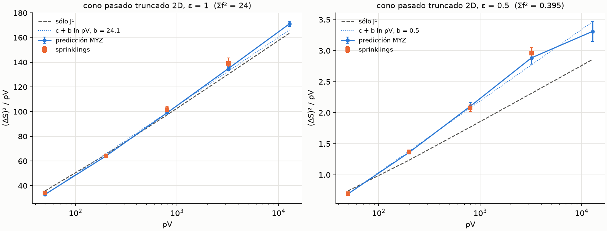

**Conclusiones:**
1. **En 2D, el escalado no depende de la región:** también en el cono pasado,
   (ΔS)² = b(ε) ρV ln ρV + O(ρV) y ΔS ∝ √(ρV ln ρV), con el mismo b(ε). La
   forma de la región sólo cambia el término O(ρV). El logaritmo es ln ρ, la
   resolución de los boosts, no una propiedad del diamante.
2. **Everpresent Λ:** el veredicto del Goal 3c se extiende a la región
   cosmológicamente relevante en 2D: el escalado no es de Poisson puro, por
   el factor logarítmico.
3. **4D (sin comprobar):** el mismo argumento da J¹ ∝ (ρV)^(2−2/d) en
   cualquier región compacta, con prefactor dependiente de la forma. La
   predicción para el cono pasado en 4D es p → 0.75, como en el diamante.
4. **Siguiente paso (1b):** FLRW. El cono pasado de FLRW llega al big bang,
   donde a(η) → 0, y eso podría cambiar el corte de rapidez. En Minkowski
   la superficie inicial no lo cambia.

## Punto 1b: el cono pasado hasta el big bang en FLRW 2D

Código: `causets/regions.py` (`ConformalPastCone`, `power_law_scale_factor`),
`causets/geometry.py` (`FLRWConeGeometry`, `power_law_rectangle_volume`),
`scripts/flrw_fluctuations.py` (resultados en `figures/flrw_sim.json`,
`figures/flrw_pred.json` y `figures/flrw_results.json`), tests en
`tests/test_flrw.py`.

**Región.** FLRW plano 2D, ds² = a(η)²(−dη² + dx²), con a = η^α. En la región
(η ≥ 0, η + |x| ≤ h) hay un big bang en η = 0. En coordenadas conformes, el
pasado causal del observador hasta el big bang es el triángulo del punto 1a.
Sólo cambia la medida, dV = a² du dv/2. Casos: α = 1 y α = 2 (en 4D
corresponderían a radiación y materia).

**Volúmenes exactos.** Los intervalos y sus intersecciones son rectángulos
en (u, v). Con 2α = p entero, el binomio de Newton da

  ∫∫ ((u+v)/2)^p du dv/2 = 2^(−p−1) Σ_k C(p,k) s₀^(p−k) Σ_{j=1}^{k+1} C(k+2,j) Δu^j Δv^(k+2−j) / ((k+1)(k+2)),

con s₀ = u₀ + v₀ ≥ 0. Todos los términos son positivos, así que no hay
cancelaciones, ni siquiera en intervalos casi nulos. Las medias ⟨N_k⟩ no
tienen forma cerrada y se obtienen por Monte Carlo.

**Muestreo.** Cerca del big bang la densidad física (∝ a²) es mucho menor que
la media, y la propuesta de intervalos, escalada con la densidad media, los
generaba demasiado pequeños. En FLRW (`local_proposal`), la escala se adapta a
a(η)² en el punto base. Hacia el futuro se mezcla con la global (mezcla
defensiva), porque el vértice inferior infravalora la densidad del intervalo.
El soporte no cambia, así que el estimador sigue siendo insesgado. Además, no
se muestrean puntos dentro de intervalos que cruzan η = 0, porque tienen peso
0 y el rechazo se volvía arbitrariamente lento. En Minkowski y de Sitter el
cálculo queda idéntico bit a bit.

**Hipótesis y criterios (fijados antes de calcular, ε = 1).** Un par casi
nulo en η tiene volumen físico ≈ a(η)² Δu Δv/2. El coeficiente de ln ρ sigue
siendo ρ∫dV Σh, y a(η) sólo añade ρ∫ln a² dV (finito) a la constante.
Predicción: el mismo b que en Minkowski. El riesgo era el big bang (a → 0).
Criterios:
- F1: volúmenes en forma cerrada frente a integración numérica (relativo 10⁻⁹).
- F2: ⟨N_k⟩ de Monte Carlo frente a sprinklings, con |z| < 4.
- F3: predicción MYZ frente a simulación, α = 1 y 2, ρV = 50 … 3200, con |z| < 4.
- F4: el b del ajuste c + b ln ρV (ρV = 50 … 12 800) es compatible a 4σ
  con el del diamante (24.43 ± 0.24).

**Resultados** (simulación: 4000/4000/3000/2000 sprinklings; MYZ: 4·10⁶
muestras por término):

| ρV | α = 1: simulación | α = 1: MYZ | z | α = 2: simulación | α = 2: MYZ | z |
|---|---|---|---|---|---|---|
| 50 | 1854 ± 45 | 1900 ± 14 | −0.97 | 1796 ± 44 | 1906 ± 20 | −2.29 |
| 200 | 14 041 ± 320 | 13 790 ± 100 | +0.74 | 13 514 ± 310 | 14 169 ± 130 | −1.97 |
| 800 | 84 824 ± 2200 | 83 273 ± 690 | +0.68 | 83 980 ± 2200 | 83 584 ± 850 | +0.17 |
| 3200 | 443 140 ± 14 000 | 451 740 ± 4300 | −0.59 | 467 770 ± 14 000 | 451 860 ± 5000 | +1.05 |

- **F1:** pasan los tests; con α = 0 se recupera el cono de Minkowski. **Se cumple.**
- **F2:** máximo |z| = 2.16. **Se cumple.**
- **F3:** 8/8 puntos con |z| < 4. **Se cumple.** Con α = 2, los dos puntos de
  ρV más bajo tienen el mismo signo (−2.3 y −2.0). Está dentro del margen,
  pero conviene tenerlo presente.
- **F4:** α = 1 da b = 24.26 ± 0.19 (z = −0.56); α = 2 da b = 24.78 ± 0.24
  (z = +1.04). **Se cumple.** El χ²/dof es 10.5 y 5.7: igual que en el cono de
  Minkowski, la ley c + b ln ρV sólo vale asintóticamente. Los aumentos de
  J¹/ρV por unidad de ln ρV son 21.9, 23.5, 23.9 y 24.0 (α = 1) y 21.9, 23.4,
  23.9 y 23.9 (α = 2), todos → 24.
- **Exponente local** de ΔS: 0.72 → 0.58 (α = 1) y 0.72 → 0.59 (α = 2), la
  misma bajada que en Minkowski.

**Tests:** 13 en `tests/test_flrw.py`. Con un error deliberado del 2 % en el
volumen de los intervalos fallan 5 de los 9 tests deterministas, y F2 da
|z| = 10–13 al recalcular las medias con ρV = 800. Restaurado el código,
pasan todos.

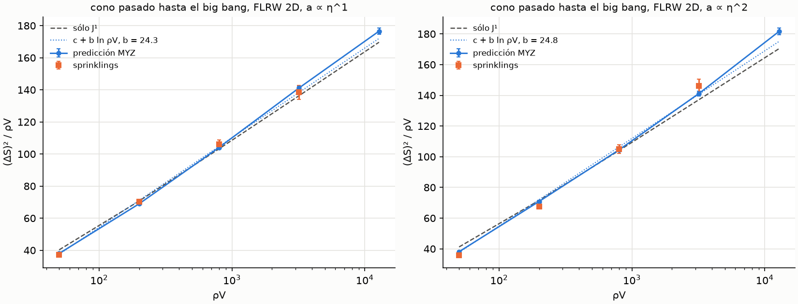

**Conclusiones:**
1. **El big bang no cambia el escalado:** en el cono pasado de FLRW 2D,
   (ΔS)² = b ρV ln ρV + O(ρV) con el mismo b que en Minkowski, para α = 1 y 2.
   El factor de escala sólo cambia el término O(ρV).
2. **En 2D, el resultado es universal** para regiones compactas
   conformemente planas (diamante, cono, cono de FLRW): ΔS ∝ √(ρV ln ρV), con
   un coeficiente que sólo depende de la acción (Σf²), no de la geometría.
3. **Everpresent Λ (2D):** en la región del modelo, las fluctuaciones de la
   acción BD no tienen escalado de Poisson puro. Les falta el factor √(ln ρV),
   que con ρV ~ 10²⁴⁰ vale ~23.5 y no es una constante.
4. **Lo que queda abierto es 4D:** el argumento predice p → 0.75, pero el
   prefactor de (ρV)^1.5 depende de la geometría. En FLRW 4D, el big bang y
   la expansión podrían cambiarlo; el exponente no debería cambiar.

## Punto 1c: el cono pasado truncado en Minkowski 4D

Código: `causets/continuum.py` (`cone_pair_integral`, `expected_abundance_cone_d`),
`scripts/cone4d_scaling.py` (resultados en `figures/cone4d_sim.json` y
`figures/cone4d_results.json`), tests en `tests/test_cone4d.py`. Mismo método
que el Paso 2: J¹, NN y el término cruzado son exactos; la varianza total se
mide sobre sprinklings, y la diferencia ("resto") es la suma de las
correlaciones de MYZ.

**Medias exactas.** El pasado de x ya está en J⁻(q), así que
y = x − τ(cosh χ, sinh χ n) está en el cono si y sólo si τ cosh χ ≤ t_x:

  ⟨Σ_pares H⟩ = Ω_{d−2} ∫_cono dV_x ∫₀^{t_x} τ^(d−1) S_d(arccosh(t_x/τ)) H(c_d τ^d) dτ,

con S_d(X) = ∫₀^X sinh^(d−2). Es una integral doble. En 2D reproduce la
fórmula del punto 1a hasta 10⁻¹².

**Prefactor asintótico (predicción).** Un par casi nulo desde x en la
dirección n puede tener rapidez hasta τe^χ/2 = ℓ(x, n), la longitud (en t)
del rayo nulo pasado dentro de la región. Con sinh²χ ≈ e^(2χ)/4:

  ⟨N_k⟩ ≈ (ρV)^1.5 · (G/V^1.5)/(8√c₄) · Γ(k+½)/k!,  G = ∫dV_x ∫_{S²} ℓ(x,n)² dΩ,  c₄ = π/24.

El exponente es universal, y la geometría sólo entra a través de G. En el cono,
ℓ = t_x y G = 4π∫t² dV: G/V^1.5 = 0.8187. En el diamante, ℓ = ((t+1)² − r²)/(2(t+1−x·n)),
y por Monte Carlo G/V^1.5 = 1.4472 ± 0.0005. Predicción: **J¹_cono/J¹_diamante →
0.566** a igual ρV.

**Calibración en el diamante (antes de calcular en el cono).** El cociente
⟨N_k⟩ exacto / asintótico, para k = 0…3, vale 0.967–0.914 con ρV = 10⁶,
0.987–0.965 con 10⁷ y 0.995–0.987 con 10⁸.

**Criterios (fijados antes de calcular en el cono):**
- H1: ⟨N_k⟩ exacto frente a sprinklings, con |z| < 4.
- H2: el cociente exacto / asintótico converge de forma monótona entre
  ρV = 10⁶, 10⁷ y 10⁸, y a 10⁸ está a menos del 3 % de 1.
- H3: la pendiente de resto/J¹ frente a ln ρV es compatible con 0 a 4σ
  (regla del Paso 2).

**Resultados** (ρV = 25 … 6400; 4000 sprinklings hasta ρV = 100, 2000 hasta 800,
1000 con 1600 y 3200, y 500 con 6400):

| ρV | (ΔS)²/ρV simulación | J¹/ρV exacto | resto/J¹ | J¹ cono/diamante | total cono/diamante |
|---|---|---|---|---|---|
| 25 | 6.6 ± 0.3 | 5.0 | 0.20 ± 0.06 | 0.090 | 0.090 ± 0.006 |
| 100 | 83.0 ± 2.4 | 59.8 | 0.40 ± 0.04 | 0.147 | 0.154 ± 0.005 |
| 400 | 621 ± 20 | 466.7 | 0.34 ± 0.04 | 0.247 | 0.250 ± 0.011 |
| 1600 | 2776 ± 126 | 2217 | 0.25 ± 0.06 | 0.345 | 0.332 ± 0.020 |
| 6400 | 10 101 ± 566 | 7522 | 0.34 ± 0.08 | 0.421 | 0.481 ± 0.040 |

(9 densidades en total en `figures/cone4d_results.json`.)

- **H1:** máximo |z| = 2.69. **Se cumple.**
- **H2:** con ρV = 10⁸, el cociente vale 0.992, 0.985, 0.981 y 0.978 para
  k = 0…3. La convergencia es monótona y la desviación máxima es 2.2 %.
  **Se cumple.** El cociente J¹_cono/J¹_diamante exacto sube de 0.516
  (ρV = 1.5·10⁵) a 0.562 (10⁸), hacia el 0.566 predicho.
- **H3:** pendiente −0.0006 ± 0.0114 (z = −0.05, χ²/dof = 1.81). **Se
  cumple.** Las correlaciones son una fracción constante de J¹:
  resto/J¹ = 0.342 ± 0.017, compatible con el 0.317 ± 0.014 del diamante.
- **Exponente local** de ΔS: 1.46 (ρV = 25→50), 1.20 (200→400) y 0.91 ± 0.05
  (3200→6400). Converge más despacio que en el diamante, porque en el cono
  los pares de gran rapidez sólo existen lejos de t = 0, y la asíntota
  (0.75) llega más tarde.

**Tests:** 6 en `tests/test_cone4d.py`. Con un error deliberado del 2 % en la
normalización de la integral del cono fallan los 2 tests de consistencia con
2D, y H1 da |z| de hasta 9.2 (con ρV = 800). Restaurado el código, pasan
todos.

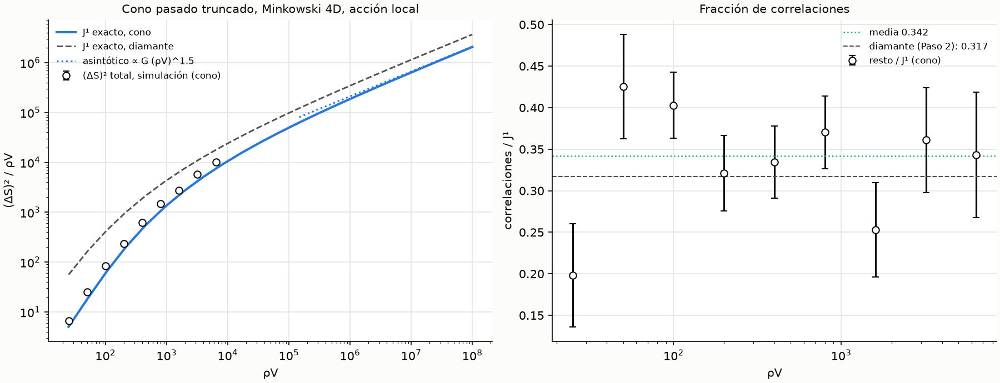

**Conclusiones:**
1. **En 4D, el escalado tampoco depende de la región:** también en el cono
   pasado, J¹ ∝ (ρV)^1.5 y las correlaciones son una fracción constante de
   J¹ (≈ 0.33 en ambas regiones). Asintóticamente, ΔS ∝ (ρV)^0.75.
2. **La geometría sólo fija la amplitud,** a través de G = ∫dV∫dΩ ℓ²: el
   rango de boosts disponible. El cono tiene un 43 % menos que el diamante,
   y esta predicción se ha verificado con J¹ exacto hasta ρV = 10⁸.
3. **Everpresent Λ (4D):** en la región del modelo (el análogo plano),
   ΔS ∝ (ρV)^0.75 y ΔΛ ∝ V^(−1/4), no V^(−1/2). Queda FLRW 4D. Allí el
   argumento predice el mismo exponente, con un G que incluye el factor de
   escala.

## Punto 1d: el cono pasado hasta el big bang en FLRW 4D

Código: `causets/geometry.py` (`conformal_interval_volume_4d`,
`FLRWConeGeometry` con `dim = 4` y su `sample_M` exacto),
`scripts/cone4d_scaling.py` (`g_flrw`), `scripts/flrw4d_scaling.py`
(resultados en `figures/flrw4d_sim_a{1,2}.json`, `figures/flrw4d_means_a{1,2}.json`
y `figures/flrw4d_results.json`), tests en `tests/test_flrw4d.py`.

**Región.** FLRW plano 4D, a = η^α, con α = 1 (radiación, a ∝ t^½) y α = 2
(materia, a ∝ t^⅔). Es el pasado causal del observador en η = h hasta el big
bang: en coordenadas conformes, el cono del punto 1c con dV = a⁴ d⁴x. Es la
región física de Everpresent Λ (sin Λ de fondo).

**Volúmenes de intervalos.** A η fijo, la sección de I(y, x) es la
intersección de dos bolas (una lente), con volumen en forma cerrada. La
integral en η, partida en los tres tramos donde la sección es polinómica, se
hace con Gauss-Legendre de 8 nodos. Es exacta para α ≤ 2. Las intersecciones
de dos intervalos no se necesitan, porque el método es el del Paso 2 y el
punto 1c (J¹ y el término cruzado con medias, total por simulación).

**Prefactor asintótico (predicción).** Un par casi nulo con tiempo propio
conforme τ y extensión λ (en η) a lo largo del rayo nulo tiene volumen físico
c₄τ⁴·w. Aquí w es la media de a⁴ sobre el intervalo, con el perfil s(λ − s)
que tiene en 4D la sección de un diamante fino a lo largo de su dirección
larga. Repitiendo el argumento del punto 1c:

  G = ∫dV_x ∫dΩ ∫₀^ℓ 2λ a(η_x − λ)⁴ / √w dλ,  w = (6/λ³)∫₀^λ a(η_y + s)⁴ s(λ − s) ds,

con ℓ = η_x (el rayo pasado llega al big bang). Con a = 1 se reduce al G del
1c. Resultado: G/V^1.5 = 1.3145 (α = 1) y 1.4194 (α = 2), frente a 0.8187
en el cono de Minkowski.

**Medias.** No tienen forma cerrada y se calculan con el Monte Carlo del
formalismo (1.6·10⁷ muestras por densidad), con la propuesta local. Con
α = 0 reproduce la integral exacta del cono (0.1–0.3 %). Los puntos de la
región se muestrean sin rechazo: η = h·Beta(4α+1, 4) y el punto espacial,
uniforme en la bola de radio h − η. El rechazo genérico aceptaba ~1 de cada
4000 puntos con α = 2 y llegó a ocupar 6 GB.

**Criterios (fijados antes de ver los resultados).** En una prueba de
precisión del Monte Carlo se vio de pasada ⟨N_0⟩/(ρV)^1.5 = 0.799 frente a
0.805 (α = 1, ρV = 10⁸). Por eso K3 usa el margen del punto 1c, sin cambiarlo.
- K1: volúmenes frente a Monte Carlo, y α = 0 frente a Minkowski.
- K2: medias frente a sprinklings, con |z| < 4.
- K3: |1 − ⟨N_k⟩/asintótico| < 3 % con ρV = 10⁸, y menor que con 10⁶.
- K4: la pendiente de resto/J¹ frente a ln ρV es compatible con 0 a 4σ.

**Resultados** (simulación: ρV = 25 … 3200, con 4000/2000/1000 sprinklings):

| | α = 1 | α = 2 |
|---|---|---|
| K2: máximo \|z\| (ambos α) | 2.48 | |
| K3: cociente con ρV = 10⁶ (k = 0…3) | 0.964 … 0.906 | 0.964 … 0.915 |
| K3: cociente con ρV = 10⁸ (k = 0…3) | 0.995 … 0.986 (±0.002) | 0.997 … 0.981 (±0.004) |
| K4: pendiente de resto/J¹ | +0.006 ± 0.011 (0.5σ) | −0.007 ± 0.011 (0.7σ) |
| resto/J¹ medio | 0.348 ± 0.016 | 0.317 ± 0.016 |
| p local, ρV = 25→50 | 1.27 ± 0.04 | 1.28 ± 0.03 |
| p local, ρV = 1600→3200 | 0.91 ± 0.04 | 0.83 ± 0.05 |

Se cumplen los cuatro criterios. Con ρV = 3200, (ΔS)²/ρV = 12 510 ± 530 (α = 1)
y 13 085 ± 589 (α = 2), frente a J¹/ρV = 9208 y 10 544.

**Tests:** 13 en `tests/test_flrw4d.py`. Hay un error deliberado que sólo
afecta a FLRW: √w → w^0.55 en G, invisible con α = 0. Con él, K3 da
desviaciones del 12–15 % (> 3 %) y falla. Restaurado el código, pasan todos.

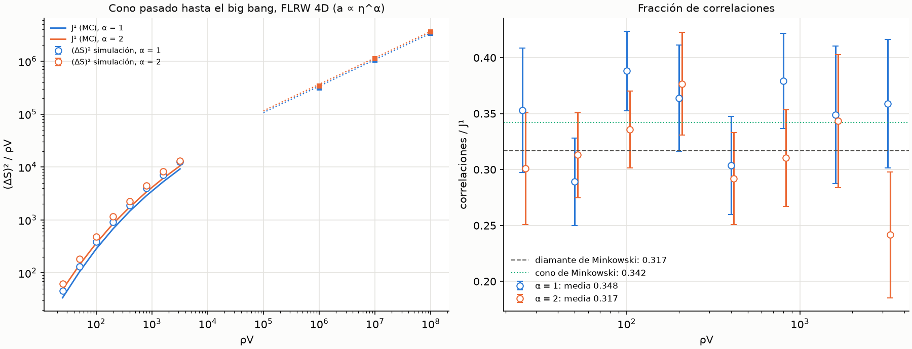

**Conclusiones:**
1. **En la región física de Everpresent Λ** (pasado causal hasta el big bang,
   FLRW 4D, radiación y materia), las fluctuaciones de la acción BD local
   siguen J¹ ∝ (ρV)^1.5 con el prefactor predicho, y las correlaciones son
   una fracción constante de J¹ (≈ 0.32–0.35, como en Minkowski).
   Asintóticamente, ΔS ∝ (ρV)^0.75 y ΔΛ ∼ ΔS/V ∝ V^(−1/4), no V^(−1/2).
2. **El factor de escala sólo cambia la amplitud,** a través de G. FLRW
   tiene más rango de boosts relativo que el cono de Minkowski (1.31–1.42
   frente a 0.82), porque el volumen se concentra cerca del observador y los
   rayos nulos pasados son largos.
3. **Con los puntos 1a–1d, el replanteo del Goal 4 queda respondido:** el
   escalado de las fluctuaciones de la acción BD es el de los boosts en todas
   las regiones probadas, incluida la del modelo. Un Λ(t) estocástico
   construido con S_BD tendría δΛ ∝ V^(−1/4) en 4D, no el escalado de Poisson
   que supone Everpresent Λ.

## Goal 4a: ¿es compatible con el Λ observado?

Código: `causets/everpresent.py`, `scripts/goal4_compatibility.py` (resultados en
`figures/goal4a_results.json`), tests en `tests/test_goal4a.py`. Es un cálculo
casi analítico: usa los prefactores medidos en los puntos 1c-1d y no hace
simulaciones nuevas.

**Suposición central (de este proyecto, no del modelo).** La fluctuación de
la acción BD en el pasado causal del observador se interpreta como una
fluctuación del término cosmológico. La acción BD reproduce la de
Einstein-Hilbert: con nuestra normalización, ⟨S⟩ → (1/2ℓ²)∫R dV, y
S_EH/ℏ = (1/16πℓ_p²)∫(R − 2Λ)dV, así que S_EH/ℏ = κS con κ = ℓ²/(8πℓ_p²). El
término cosmológico es ΛV/(8πℓ_p²) (Das-Nasiri-Yazdi 2023, ec. 3.12). Queda

  **δΛ·ℓ² = ΔS/(ρV)**,

sin dependencia de ℓ_p. Aplicada a la acción de Poisson de Model 1
(ΔS_EH = √N/2, ecs. 3.11-3.13), esta conversión reproduce exactamente su
δΛ = 8πα/√V (test E2). Con la amplitud de los puntos 1c-1d,
δΛ·ℓ² = A·(ρV)^(−1/4), donde A² = (1 + r)(G/V^1.5)/(8√c₄)·Σ_n f(n)² Γ(n+½)/n!.

**Acción suavizada.** Con ε = (ℓ/ℓ_k)⁴, Σ_n f_ε² Γ(n+½)/n! → 4.112·ε^(5/2):
la amplitud cae como A ∝ ε^(5/4) = (ℓ/ℓ_k)⁵. El término cruzado con N sigue
anulándose. Las dos cosas se comprueban numéricamente (E3, E4).

**Fondo.** ΛCDM de Planck 2018 (H₀ = 67.4 km/s/Mpc, Ω_m = 0.315,
Ω_r = 9.1·10⁻⁵). Volumen del pasado causal hoy: V = 6.4·10²⁴² ℓ_p⁴.
Λ_obs = 3Ω_Λ H₀² = 2.85·10⁻¹²² ℓ_p⁻². G/V^1.5 entre 1.31 y 1.42 (radiación
y materia); r entre 0.32 y 0.35 (local) o entre 0 y 1 (suavizada, no medida).

**Reglas de decisión (fijadas antes de calcular):**
- D1: la acción local queda excluida si la ℓ necesaria para δΛ = Λ_obs deja
  hoy ρV < 10³.
- D2: la acción suavizada sigue abierta si la ℓ_k necesaria es menor que la
  cota del LHC, ℓ_k ≲ 10⁻¹⁹ m. La cita es de Belenchia, Benincasa, Liberati,
  Marin, Marino & Ortolan, Phys. Rev. Lett. 116, 161303 (2016),
  arXiv:1512.02083.
- D3: calcular la envolvente δΛ/(3H²) frente a z.

**Resultados:**

| | Resultado |
|---|---|
| D1: δΛ/Λ_obs, acción local con ℓ = ℓ_p | 1.2–1.6 · 10⁶² |
| D1: δΛ/Λ_obs, acción local con ℓ = ℓ_cs (α = 0.01, ℓ_cs = 7.1 ℓ_p) | 1.6–2.2 · 10⁶¹ |
| D1: ℓ necesaria | 1.9–2.5 · 10²⁷ m (≈ 15 radios de Hubble; ρV hoy < 1) → **excluida** |
| D2: ℓ_k necesaria (ℓ = ℓ_p) | 2.5–2.7 · 10⁻²³ m (ℓ_k/ℓ ≈ 1.6 · 10¹², ε ≈ 10⁻⁴⁹) |
| D2: ℓ_k necesaria (ℓ = ℓ_cs) | 1.2–1.3 · 10⁻²² m |
| D2: frente a la cota del LHC (10⁻¹⁹ m) | por debajo → **vía abierta** |
| D3: w efectivo de la envolvente (z = 10–100) | BD: −0.50; Model 1: +0.006 |
| D3: δΛ/(3H²) en z = 1100 | BD suavizada: 4·10⁻⁵; Model 1: 0.52 |

**Tests:** 14 en `tests/test_goal4a.py`. Con errores deliberados (κ con 8π en
lugar de 16π, y la constante asintótica × 1.05) fallan E2 y E4. Al hacer esa
comprobación apareció que E2 era un test vacío: `pytest.approx` aplica
siempre una tolerancia absoluta de 10⁻¹², y los valores de δΛ en unidades de
Planck son ~10⁻¹²¹. Ahora compara el cociente. Se revisaron todas las demás
comparaciones con `approx` del proyecto: todas usan cantidades ≳ 10⁻³ y no
están afectadas. La tolerancia del test de D3 (0.05) se fijó después de ver
los valores. La expectativa analítica (w = −½ porque δΛ ∝ V^(−1/4) ∝ H en
la era de materia) sí era previa.

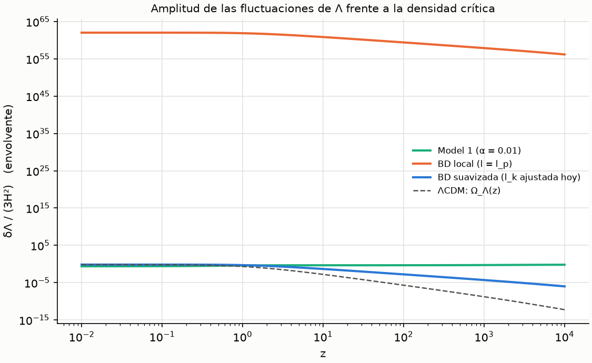

**Conclusiones:**
1. **La acción BD local queda excluida** como origen de un Λ fluctuante: da
   unos 61–62 órdenes de magnitud de más, y no hay ninguna escala de
   discreción que lo arregle sin destruir el régimen continuo.
2. **La acción suavizada puede dar la amplitud observada**, con una escala
   de no-localidad ℓ_k ≈ 10⁻²² m. Ese valor es compatible con la cota actual
   del LHC y cae justo en el rango que los experimentos optomecánicos
   propuestos podrían explorar (10⁻²² – 10⁻²⁹ m, Belenchia et al. 2016). Es
   una predicción contrastable, pero con un precio: ℓ_k es un parámetro
   ajustado (ℓ_k/ℓ_p ~ 10¹²), así que reaparece el problema de la
   coincidencia que Model 1 resuelve de forma natural (α ~ 0.01, ℓ_cs ~ ℓ_p).
3. **La evolución es distinta de la de Model 1:** la envolvente se comporta
   como un fluido con w ≈ −½ en la era de materia. Es despreciable en el CMB
   y crece hasta dominar hoy, a medio camino entre ΛCDM (w = −1) y Model 1
   (w ≈ 0). Que sea compatible con supernovas y BAO no se puede decidir sólo
   con la envolvente. Hace falta la correlación temporal de ΔS a lo largo de
   la línea de universo del observador, porque Λ(t) es un proceso
   estocástico de media cero y la envolvente sólo da su desviación típica.
4. **Siguiente paso, si se quiere seguir:** calcular esa correlación (la
   covarianza de ΔS entre los conos pasados de dos instantes) y, con ella,
   un Λ(t) estocástico que se pueda comparar con los datos.

## Goal 4b: correlación temporal y Λ(t) estocástico

### 4b-1: correlación de la acción entre conos pasados anidados

Código: `scripts/goal4b_correlations.py` (sprinklings en
`figures/goal4b_sim_{mink4,flrw4}.json`, análisis en `figures/goal4b_results.json`).
Los conos pasados de los instantes t₁ < t₂ < … de una misma línea de universo
están anidados. Como la región es causalmente convexa, cada par de un subcono
es también par del cono mayor y tiene la misma cardinalidad, así que
S(t_j) = S(t_i) + incremento. Con un solo sprinkling del cono mayor
(ρV = 3200) se obtiene S en los subconos de ρV = 200, 500, 1250 y 3200. Acción
local 4D, Minkowski y FLRW con a = η² (materia), 4000 sprinklings por
geometría. Al principio se hicieron 1000; se ampliaron porque B2 no era
concluyente.

**Criterios (fijados antes de calcular):**
- B1: κ_ij = Cov(S_i, S_j − S_i)/Var(S_i) compatible con 0 a 4σ en todos los
  pares (incrementos independientes, es decir, paseo aleatorio).
- B2: |κ_ij| < 0.2 en todos los pares (independencia práctica).
- B3: Var(S_j) de los subconos igual a la del cono completo de los puntos
  1c/1d a la misma ρV, con |z| < 4.

| | Minkowski 4D | FLRW 4D (materia) |
|---|---|---|
| κ, pares adyacentes 200→500, 500→1250, 1250→3200 | +0.07 ± 0.04, +0.10 ± 0.04, +0.03 ± 0.04 | +0.12 ± 0.04, +0.05 ± 0.03, +0.06 ± 0.03 |
| B1 (máx. \|κ\|/σ) | sí (2.8σ) | sí (3.3σ) |
| B2 | **no**: κ(200→1250) = 0.29 ± 0.12 | **no**: κ(200→1250) = 0.23 ± 0.09 |
| B3 (\|z\|) | sí (1.18, 0.06) | sí (0.99, 1.16) |

**B2 falla tal como se formuló, también con 4000 sprinklings.** Los pares
que lo incumplen son los no adyacentes que salen de ρV = 200, con errores de
0.1–0.3: el criterio compara el valor central sin su error, y estaba mal
planteado. No se cambia a posteriori. Los pares adyacentes, que son los mejor
medidos, cumplen todos |κ| < 0.2. Su media ponderada (las 6) es
**κ = 0.069 ± 0.015**: una correlación positiva pequeña pero significativa
(≈ 4.6σ en conjunto, aunque ningún par individual llega a 4σ). La acción no es
exactamente un paseo aleatorio. Las correlaciones medidas quedan algo por
encima de la del paseo aleatorio, √(Var S_i/Var S_j). Escribiendo
corr = corr_PA^β, se obtiene **β = 0.88–0.97** en los 12 pares (β = 1 es el
paseo aleatorio). Con la acción suavizada no se ha medido.

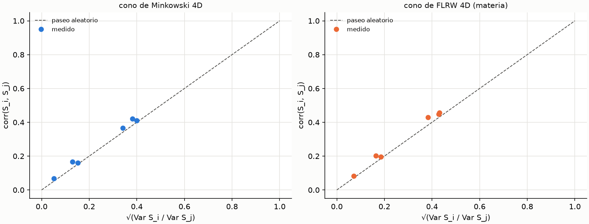

### 4b-2: Λ(t) estocástico con retroacción

Código: `causets/stochastic_lambda.py`, `scripts/goal4b_lambda.py` (resultados
en `figures/goal4b_lambda.json`), tests en `tests/test_goal4b.py`.

**Modelo.** A lo largo de la línea de universo, Λ(t) = λ V(t)^(−q) s(t). Aquí
V es el volumen del pasado causal y s es un proceso de Ornstein-Uhlenbeck en
ln V, con varianza 1 y corr(s₁, s₂) = (V₁/V₂)^c.
- Model 1 (Das-Nasiri-Yazdi 2023, ecs. 3.13 y 3.15): ΛV es un paseo
  aleatorio con Var ∝ V, así que q = c = ½ y λ = 8πα.
- Acción BD (Goal 4a y 4b-1): ΛV ∝ ΔS con Var ∝ V^(3/2), así que q = ¼ y
  c = ¾β.

La expansión se integra con retroacción, (H/H₁₀₀)² = ω_r/a⁴ + ω_m/a³ + Λ/3,
con ω_m y ω_r de Planck 2018. V se acumula a partir de los momentos
∫a⁴η^k dη. Se sigue la convención de DNY (sec. 5.2): Λ = 0 antes de
z = 10⁴, con S₀ = 0. Si H² < 0, la realización cuenta como colapsada. h y
Ω_Λ0 salen de cada realización. λ se traduce en ℓ_k con la amplitud del
Goal 4a (FLRW materia, r = 0.33, ℓ = ℓ_p).

**Criterios (fijados antes de calcular):**
- C1: con Λ constante se reproduce ΛCDM (h, Ω_Λ, d_L, E(z)) con error relativo < 10⁻³.
- C2: el proceso OU da corr = (V₁/V₂)^c a 4σ.
- C3: V(a = 1) coincide con `everpresent.past_cone_volume` con error relativo < 10⁻³.
- Comparación: misma regla para los dos modelos. Fracción de realizaciones
  «tipo ΛCDM»: Ω_Λ0 y h en [0.6, 0.8]; forma de μ(z) (restada su media, que
  absorbe H₀ y la magnitud de las SN) a menos de 0.1 mag de ΛCDM en
  0.01 < z < 2.3; |E/E_ΛCDM − 1| < 5 % en z = 0.5, 1 y 2. No es un ajuste a
  datos reales.

**Validación externa (añadida DESPUÉS de ver resultados).** Al principio Λ
se activaba desde z = 10⁶, y Model 1 colapsaba en el 98.6 % de los casos.
Con la convención de DNY, las tasas de finalización de Model 1 son
10 000 / 3258 / 575 de 10 000 (α = 0.005 / 0.01 / 0.012), frente a las
publicadas 9990 / 3228 / 535 (DNY 2023, sec. 5.1). Esto se convirtió en test
(a 4σ binomial).

**Resultados** (2000 realizaciones por punto; medianas sobre las no colapsadas):

| Modelo | Amplitud | Tipo ΛCDM | Colapsan | Ω_Λ0 mediana | h mediana |
|---|---|---|---|---|---|
| Model 1 | α = 0.003–0.008 | 0 % | 0–20 % | 0.01–0.06 | 0.38–0.39 |
| Model 1 | α = 0.012 | 0 % | 94 % | 0.12 | 0.40 |
| Model 1 | α ≥ 0.02 | 0 % | 100 % | — | — |
| BD, β = 0.7–1 | λ = 0.3 (ℓ_k = 3.2·10⁻²³ m) | 0.05–0.10 % | 5–8 % | 0.12–0.14 | 0.40–0.41 |
| BD, β = 0.7–1 | λ = 0.6 (ℓ_k = 2.8·10⁻²³ m) | 0 % | 39–48 % | 0.49–0.50 | 0.53–0.54 |
| BD, β = 0.7–1 | λ = 1 (ℓ_k = 2.5·10⁻²³ m) | 0 % | 63–73 % | 0.72–0.73 | 0.72–0.73 |
| BD, β = 0.7–1 | λ = 1.5–6 (ℓ_k = 1.8–2.3·10⁻²³ m) | 0 % | 74–97 % | 0.84–0.98 | 0.93–3.1 |

Las medianas sobre las realizaciones que no colapsan están sesgadas hacia
Λ > 0, porque las de Λ negativo grande son justo las que colapsan.

**Diagnóstico (λ = 1, β = 0.85).** Con la amplitud que da los valores
típicos de hoy, lo que falla es la forma de la historia de expansión: la
mediana de max|Δμ| es 0.33 mag, y la de |E/E_ΛCDM − 1| está entre el 13 y
el 18 %. El «reloj» del proceso es ln V, y V crece mucho a z bajo, así que Λ
se descorrelaciona entre z = 2 y hoy. Que β esté entre 0.7 y 1 apenas cambia
nada, así que la imprecisión en κ no afecta a la conclusión.

**Tests:** 9 en `tests/test_goal4b.py` (C1, C3, C2 ×3, Model 1 frente a DNY
×3, y la conversión λ → ℓ_k frente al Goal 4a). Con errores deliberados
(momento del volumen 3 → 2.9; tasa del OU × 0.9) fallan C3 y los tres C2. C1
no detecta el primero, como es de esperar: con Λ constante, V no interviene.

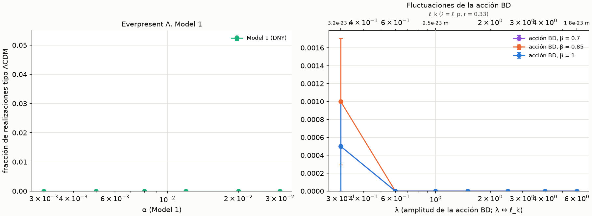

**Conclusiones:**
1. **La acción BD local en conos pasados anidados es casi un paseo
   aleatorio**, con una pequeña memoria positiva (κ ≈ 0.07, β ≈ 0.9). Es la
   misma estructura que Model 1, pero con un reloj Var ∝ V^(3/2) en vez de V.
2. **Ninguno de los dos modelos da historias de tipo ΛCDM con una
   probabilidad apreciable** según este criterio. Model 1 con S₀ = 0 da
   Ω_Λ0 ≈ 0.1 o colapsa, y DNY necesitan un S₀ > 0. La acción BD suavizada,
   con ℓ_k ≈ 2.5·10⁻²³ m, da valores típicos de hoy correctos
   (Ω_Λ0 ≈ h ≈ 0.72), pero colapsa en dos de cada tres casos y su Λ(t) cambia
   demasiado a z ≲ 2 como para reproducir la forma de μ(z) y H(z).
3. **Límites:** κ y β se han medido sólo con la acción local y hasta
   ρV = 3200. Que valgan igual para la suavizada en el régimen físico
   (ρV ~ 10²⁴²) es una extrapolación. El criterio «tipo ΛCDM» es un sustituto
   de un ajuste a datos (SN, BAO, CMB), que no se ha hecho.

## Goal 4c: comparación con supernovas reales (Pantheon+SH0ES)

Código: `causets/supernovae.py` (likelihood), `scripts/goal4c_sn_fit.py`
(resultados en `figures/goal4c_lcdm.json`, `figures/goal4c_seeds_{model1,bd}.json`
y `figures/goal4c_results.json`), tests en `tests/test_goal4c.py`. Los datos
públicos no se versionan: se descargan con `scripts/get_pantheon.sh`, que
comprueba las sumas SHA-256.

**Por qué este goal.** En el Goal 4b, el criterio «tipo ΛCDM» daba 0 % también
para Model 1. Sin embargo, DNY (2024, sec. 4) encuentran semillas de Model 1
que ajustan las supernovas tan bien como ΛCDM. El criterio no discriminaba, y
hacía falta comparar los dos modelos con datos reales y con el método de DNY.

**Método** (el de DNY 2024, sec. 4.1):
- Cada «semilla» fija la secuencia de números aleatorios del proceso. Se
  implementa con `evolve(..., noise=...)`, de modo que la historia de una
  semilla no depende del lote ni de los parámetros de las otras
  realizaciones; hay un test que lo comprueba.
- Para cada semilla se busca el mínimo de χ² en (ω_m, amplitud, M_B):
  - M_B se minimiza analíticamente.
  - (ω_m, amplitud) se recorren con una rejilla 10 × 10 y dos refinamientos
    locales 5 × 5. DNY usan MCMC por semilla.
- Rangos de búsqueda: ω_m ∈ [0.02, 0.8]; para Model 1, α ∈ [0.001, 0.025]
  (el prior de DNY); para la acción BD, λ ∈ [0.1, 10].
- Acción BD con β = 0.9 (Goal 4b-1). 10 000 semillas por modelo, las mismas
  para los dos.
- Datos: Pantheon+SH0ES con el corte estándar (zHD > 0.01 o calibrador; 1657
  curvas de luz, 77 de calibradores) y covarianza STAT+SYS.
- El χ² se comprime de forma exacta: μ(z) se interpola con un spline en
  ln z sobre 64 nodos, y χ² queda como una forma cuadrática de dimensión 65.
  Se desarrolla alrededor de un ΛCDM de referencia; desarrollada en cero
  había errores de redondeo de ~0.1 en χ², que aparecieron en el test V2.

**Criterios (fijados antes de calcular, en el docstring del script) y resultados:**

| Criterio | Resultado |
|---|---|
| V1: χ² mínimo de ΛCDM igual al de DNY (1485.3), con \|Δ\| < 2 | **no**: 1452.0 |
| V2: χ² comprimido igual al directo, \|Δ\| < 0.01 | sí (tests) |
| V3: Model 1, fracción de semillas «buenas» (χ² < χ²_ΛCDM + 14.7) en [0.001, 0.009] | sí: 0.0025 ± 0.0005 (DNY ≈ 0.003) |
| V3: Model 1, fracción de semillas «mejores» (χ² < χ²_ΛCDM) igual a la de DNY (16/90 000) a 4σ | sí: 2/10 000, z = +0.16 |
| Comparación: diferencia en la fracción de buenas, a 4σ | **indistinguibles**: z = +2.7 |

**V1.** Nuestro mejor ajuste de ΛCDM (Ω_m = 0.332, H₀ = 73.5) coincide con el
publicado para Pantheon+SH0ES (Brout et al. 2022: Ω_m = 0.334 ± 0.018,
H₀ = 73.6 ± 1.1). La integración de `evolve` reproduce ese χ² con un error de
0.008. Ninguna variante sencilla (ω_m u Ω_m fijos) da el 1485.3 de DNY, así
que su configuración exacta no se ha podido reconstruir. Como estaba previsto,
los umbrales se toman relativos a nuestro χ²_ΛCDM = 1452.0: «mejores» es
χ² < 1452.0 y «buenas» es χ² < 1466.7.

**Resultados** (10 000 semillas por modelo; parámetros de las semillas buenas,
mediana y percentiles 16-84 %):

| | Model 1 | Acción BD (β = 0.9) |
|---|---|---|
| Semillas buenas | 25 (0.25 %) | 48 (0.48 %) |
| Semillas mejores que ΛCDM | 2 | 2 |
| χ² mínimo (ΛCDM: 1452.0) | 1446.8 | 1450.4 |
| H₀ (km/s/Mpc) | 72.0 (70.1–72.6) | 72.3 (69.8–74.4) |
| Ω_m0 | 0.58 (0.43–0.71) | 0.49 (0.37–0.59) |
| Amplitud | α = 0.0071 (0.0057–0.0094) | λ = 0.35 (0.24–0.46) |
| Escala de no localidad | — | ℓ_k ≈ 3.1·10⁻²³ m (2.9–3.4·10⁻²³ m) |

Las medianas de Ω_m y α de Model 1 coinciden con el promedio bayesiano de DNY
(Ω_m = 0.58 ± 0.19, α = 0.0085 ± 0.0017). Esta comparación no formaba parte del
criterio. En torno al 45 % de las semillas de los dos modelos tienen su mejor
ajuste en el borde inferior de la amplitud (Λ ≈ 0, materia sola). Son siempre
ajustes malos, con χ² ≳ 2000, así que no afectan a las fracciones de semillas
buenas.

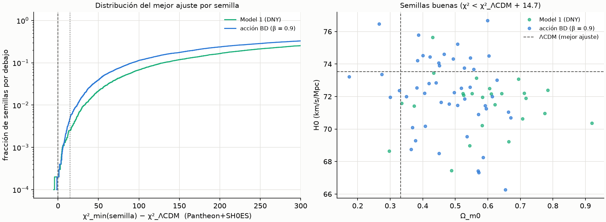

**Tests:** 5 en `tests/test_goal4c.py`: tamaño de la muestra, V2 (forma
cuadrática exacta, M_B en el mínimo, spline frente a ΛCDM exacta) y
determinismo por semilla. Se saltan si faltan los datos. Comprobación con
errores deliberados:
- Un término cruzado ×0.95 hace fallar V2a.
- z × 1.002 en el spline hace fallar V2b.
- Un ruido que depende del lote hace fallar el test de determinismo.

Un primer error deliberado (ruido dependiente de ω_m) no lo detectaba, porque
la realización comparada tenía la misma ω_m en los dos lotes. El test de
determinismo también estaba mal escrito al principio: usaba una realización
que colapsaba y comparaba NaN.

**Conclusiones:**
1. **Con supernovas, las fluctuaciones de la acción BD son tan viables como
   Model 1.** Producen historias que, de vez en cuando (≈ 0.5 % de las
   semillas), ajustan Pantheon+SH0ES tan bien como ΛCDM. En la fracción de
   semillas buenas, la acción BD queda por delante a 2.7σ, sin llegar al
   umbral de 4σ.
2. **La escala ℓ_k ≈ 3·10⁻²³ m queda fijada por los datos** y coincide con la
   del Goal 4a, que salía sólo de la amplitud de Λ hoy. Model 1 tiene α como
   parámetro libre; la acción BD tiene una escala física de no localidad que
   los experimentos optomecánicos propuestos podrían medir (Belenchia et al.
   2016).
3. **Esto matiza el Goal 4b-2.** Allí no se permitía a cada historia ajustar
   ω_m y la amplitud, y el criterio exigía parecerse a una cosmología fija.
   Con el método de DNY, los dos modelos tienen la misma rareza: la mayoría
   de las historias falla, y unas pocas ajustan muy bien.
4. **Límites:**
   - Sólo se han usado supernovas; DNY también usan el CMB con el likelihood
     completo de Planck, y faltan BAO y CMB.
   - La búsqueda por rejilla puede infraestimar las fracciones frente a un
     MCMC, aunque igual para los dos modelos.
   - β está fijado a 0.9 y se midió con la acción local.
   - Las semillas buenas tienen Ω_m ≈ 0.5, por encima del valor de lentes
     débiles y cúmulos (~0.3). DNY encuentran lo mismo con Model 1.

## Goal 4d: supernovas + BAO + CMB

Código: `causets/cmb_bao.py`, `scripts/goal4d_combined.py` (resultados en
`figures/goal4d_validation.json`, `figures/goal4d_lcdm{,_cal}.json`,
`figures/goal4d_seeds_{model1,bd}{,_cal}.json` y `figures/goal4d_results.json`),
tests en `tests/test_goal4d.py`. Los datos de DESI se descargan con
`scripts/get_pantheon.sh`, que también comprueba sus sumas SHA-256.

**Por qué este goal.** El Goal 4c sólo usaba supernovas, que miden la *forma*
de la historia de expansión a z < 2.3 pero no su escala absoluta ni su
relación con el universo temprano. DNY (2024) añaden el CMB. Aquí se añaden
el BAO de DESI DR2 y el CMB, este último en forma de priors de distancia.

**Método.** El mismo ajuste por semilla del Goal 4c (las mismas 10 000
semillas, rejilla y refinamientos), con χ² = SN + BAO + CMB:
- **BAO:** DESI DR2 (arXiv:2503.14738), D_V/r_d, D_M/r_d y D_H/r_d: 13 medidas
  en 7 redshifts con su covarianza (versión gaussiana del likelihood de Cobaya).
- **CMB:** priors de distancia de Planck 2018 (Chen, Huang & Wang 2019, tabla I):
  R = √ω_m D_M(z*) y l_A = π D_M(z*)/r_s(z*). ω_b se fija a 0.02236 y se
  usa la gaussiana condicionada de (R, l_A).
- **Horizonte de sonido:** r_s = ∫ c_s dη, integrado sobre la historia de cada
  realización, con Λ estocástico desde z = 10⁴. z* y z_drag vienen de los
  ajustes de Hu & Sugiyama (1996) y Eisenstein & Hu (1998), desplazados por
  una constante para que den los de Planck 2018 en su mejor ajuste ΛCDM.
- **Limitación conocida, fijada antes de calcular:** los priors de distancia
  suponen física temprana de tipo ΛCDM. Valen para la acción BD (Λ/3H² ~
  4·10⁻⁵ en z = 1100, Goal 4a), pero no para Model 1 (~0.5). Para Model 1 el
  χ²_CMB es sólo orientativo; la referencia es el análisis completo de DNY
  con el likelihood de Planck (Δχ² > 150 frente a ΛCDM).

**Criterios (fijados antes de calcular ningún χ² de BAO o CMB, en el
docstring del script) y resultados:**

| Criterio | Resultado |
|---|---|
| W1: mejor ajuste ΛCDM de Planck 2018 → r_* y r_drag a menos del 0.3 %, R y l_A a menos de 1σ | sí, tras corregir un error (abajo): r_* = 144.51 Mpc (+0.08 %), r_drag = 147.17 Mpc (+0.08 %), R a +0.03σ, l_A a −0.92σ |
| W2: ΛCDM con BAO sola → Ω_m = 0.2975 ± 0.0086 (DESI), a menos de 1σ | sí: 0.2972 (−0.04σ) |
| Principal: diferencia en la fracción de semillas buenas (χ² < χ²_ΛCDM + 14.7) a 4σ | **0 de 10 000 en los dos modelos**: f < 3·10⁻⁴ (95 %); indistinguibles |
| Secundario: semillas con Δχ²_CMB < 9 | Model 1: 0.35 %; acción BD: 1.5 % |

**W1 falló al principio** (l_A a −1.45σ). Un test escrito antes de ver W1
(r_s frente a una integral directa con `quad`) mostró un sesgo de 1.3·10⁻⁴ en
r_s: `evolve` arrancaba en a = 10⁻⁵ con η de radiación pura, sin la materia.
Se corrigió con un arranque exacto (`exact_start=True`, sólo en el Goal 4d,
para que los resultados de 4b y 4c no cambien), y W1 pasó a −0.92σ. Probar
con el ω_r de Planck (N_eff = 3.046) lo empeoraba (+5.7σ) y no se usó.

**Comprobación de robustez (decidida después de que W1 fallara):** una
variante «calibrada» multiplica l_A y r_d por los factores que hacen que el
mejor ajuste de Planck dé exactamente sus valores (1.00027 y 0.99920). Las
conclusiones no cambian (tabla de abajo).

**ΛCDM combinado:** h = 0.6835, Ω_m = 0.300, χ² = 1504.0 (SN 1486.3, BAO 10.8,
CMB 6.9); calibrado: χ² = 1503.8. El χ²_SN de este ajuste (1486.3) está a 1.0
del 1485.3 de DNY, que no se pudo reproducir en el Goal 4c (V1). Hipótesis a
posteriori: el χ² de referencia de DNY es el de supernovas de un ΛCDM
ajustado también al CMB, no el de un ajuste sólo a supernovas.

**Resultados** (10 000 semillas por modelo):

| | Model 1 | Acción BD (β = 0.9) |
|---|---|---|
| Semillas buenas / mejores que ΛCDM | 0 / 0 | 0 / 0 |
| Calibrado: buenas / mejores | 0 / 0 | 0 / 0 |
| Δχ² mínimo frente a ΛCDM (calibrado) | +364 (+366) | +124 (+119) |
| Mejor semilla: Δχ² SN / BAO / CMB | +318 / +29 / +18 | +37 / +82 / +4.5 |
| Buenas del Goal 4c (sólo SN) que siguen siendo buenas | 0 de 25 | 0 de 48 |

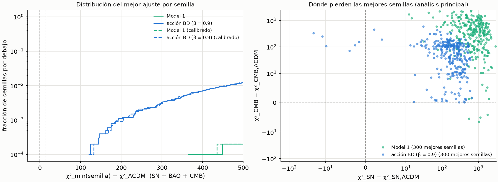

**Tests:** 5 en `tests/test_goal4d.py`: r_s sin bariones = η/√3; r_s frente a
una integral directa (< 10⁻⁴, con `exact_start`); anclaje de z* y z_drag; la
gaussiana condicionada del CMB; χ²_BAO = 0 en los datos. Se saltan si faltan
los datos. Error deliberado: c_s con √2.9 en vez de √3 hace fallar los dos
tests de r_s.

**Conclusiones:**
1. **Con supernovas + BAO + CMB, ni Model 1 ni la acción BD producen historias
   que ajusten como ΛCDM** (0 de 10 000; f < 3·10⁻⁴ al 95 %). Un motivo
   probable: las semillas buenas del Goal 4c tenían Ω_m ≈ 0.5, y BAO y CMB
   piden Ω_m ≈ 0.30 (no se ha comprobado semilla a semilla).
2. **Para Model 1 coincide con DNY** (Δχ² > 150 con el likelihood completo de
   Planck), por un camino independiente: aquí el CMB entra sólo como priors de
   distancia, y aun así el mínimo es Δχ² = +364.
3. **La acción BD queda mucho más cerca (+124), pero sigue excluida** en esta
   forma (proceso de Ornstein-Uhlenbeck con β = 0.9 y la retroacción del Goal
   4b-2). Su mejor semilla encaja con el CMB, pero no consigue a la vez la forma
   de D(z) que piden las supernovas y la escala que piden las BAO. Que cumpla
   el CMB es esperable: en la acción BD, Λ es despreciable en z ~ 1100.
4. **Esto corrige la conclusión 1 del Goal 4c:** con supernovas solas los dos
   modelos parecían viables, pero era porque las supernovas no fijan Ω_m.
5. **Límites:**
   - La búsqueda por rejilla puede infraestimar las fracciones frente a un
     MCMC. Con un mínimo de +124, no cambiaría el veredicto.
   - β = 0.9 y la forma del proceso vienen de la acción local (Goal 4b-1).
     Otra dinámica (otro β u otro acoplamiento entre ΔS y Λ) no está
     explorada.
   - Para Model 1, el χ²_CMB con priors de distancia es sólo orientativo.

## Referencias

- Bombelli, Lee, Meyer & Sorkin (1987), Phys. Rev. Lett. 59, 521 — sprinkling de Poisson.
- Myrheim, J. (1978), "Statistical geometry", CERN preprint TH-2538 — ordering fraction y dimensión.
- Meyer, D. A. (1988), tesis doctoral, MIT — expresión cerrada de f(d).
- Reid, D. D. (2003), Phys. Rev. D 67, 024034, arXiv:gr-qc/0207103 — estimador práctico de dimensión.
- Surya, S. (2019), Living Rev. Relativ. 22, 5 — revisión general.
- Benincasa & Dowker (2010), Phys. Rev. Lett. 104, 181301, arXiv:1001.2725 — acción BD en 4D.
- Sorkin, R. D. (2007), arXiv:gr-qc/0703099 — d'Alembertiano 2D y suavizado ε.
- Benincasa, Dowker & Schmitzer (2011), Class. Quantum Grav. 28, 105018, arXiv:1011.5191 — acción 2D y su media.
- Das, Nasiri & Yazdi (2023), JCAP 10, 047, arXiv:2304.03819 — Everpresent Λ (I), Model 1.
- Belenchia, Benincasa, Liberati, Marin, Marino & Ortolan (2016), Phys. Rev. Lett. 116, 161303, arXiv:1512.02083 — cotas a la escala de no-localidad ℓ_k.
- Scolnic et al. (2022), ApJ 938, 113, arXiv:2112.03863 — muestra Pantheon+ (Goal 4c).
- Brout et al. (2022), ApJ 938, 110, arXiv:2202.04077 — likelihood y cosmología de Pantheon+ (Goal 4c).
- Riess et al. (2022), ApJL 934, L7, arXiv:2112.04510 — calibradores Cefeidas de SH0ES (Goal 4c).
- DESI Collaboration (2025), arXiv:2503.14738 — BAO de DESI DR2 (Goal 4d).
- Chen, Huang & Wang (2019), JCAP 02, 028, arXiv:1808.05724 — priors de distancia del CMB de Planck 2018 (Goal 4d).
- Hu & Sugiyama (1996), ApJ 471, 542 — ajuste de z* (Goal 4d).
- Eisenstein & Hu (1998), ApJ 496, 605 — ajuste de z_drag (Goal 4d).
- Uhlenbeck & Ornstein (1930), Phys. Rev. 36, 823 — proceso de Ornstein-Uhlenbeck (Goal 4b-2).
- Planck Collaboration (2020), Astron. Astrophys. 641, A6, arXiv:1807.06209 — parámetros cosmológicos de fondo.
- Das, Nasiri & Yazdi (2024), JCAP 10, 076, arXiv:2307.13743 — Everpresent Λ (II), tests cosmológicos.
- Dowker & Glaser (2013), Class. Quantum Grav. 30, 195016, arXiv:1305.2588 — f_d(n, ε) en dimensión d.
- Moradi, Yazdi & Zilhão, arXiv:2407.03395 — kernels de fluctuación (Goal 3).
